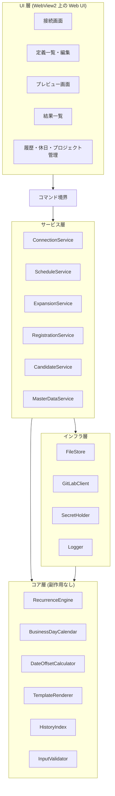
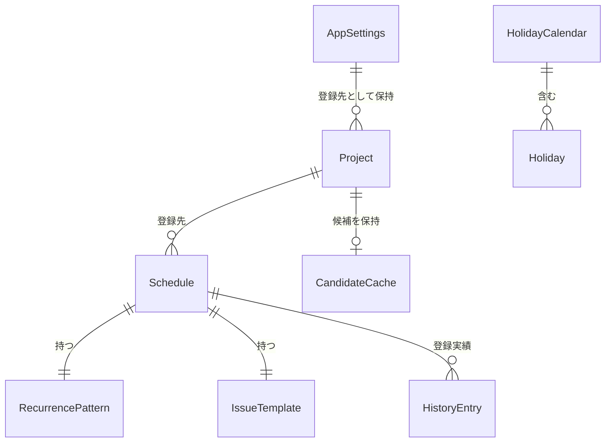
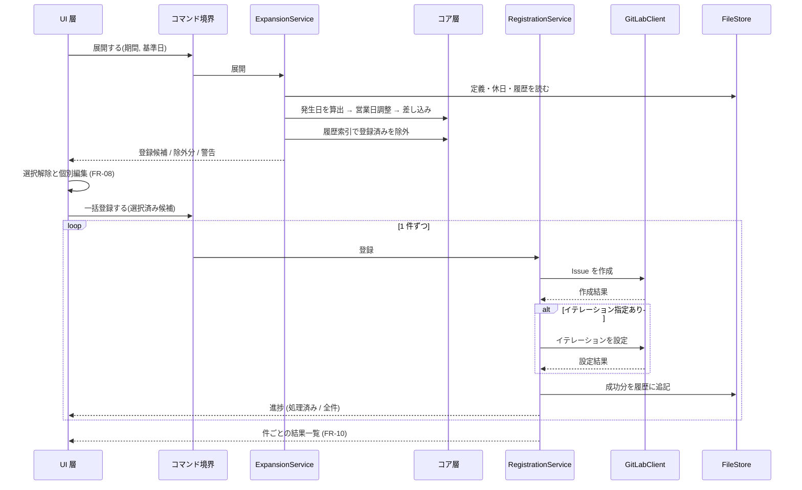
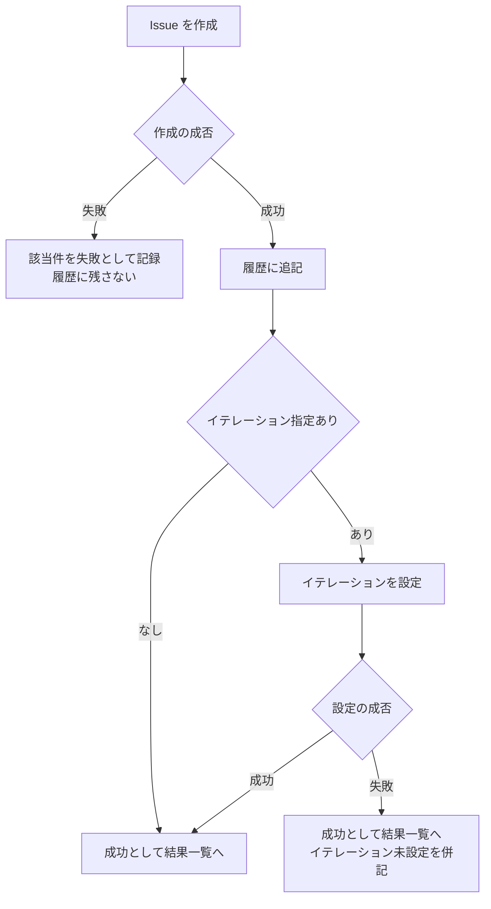
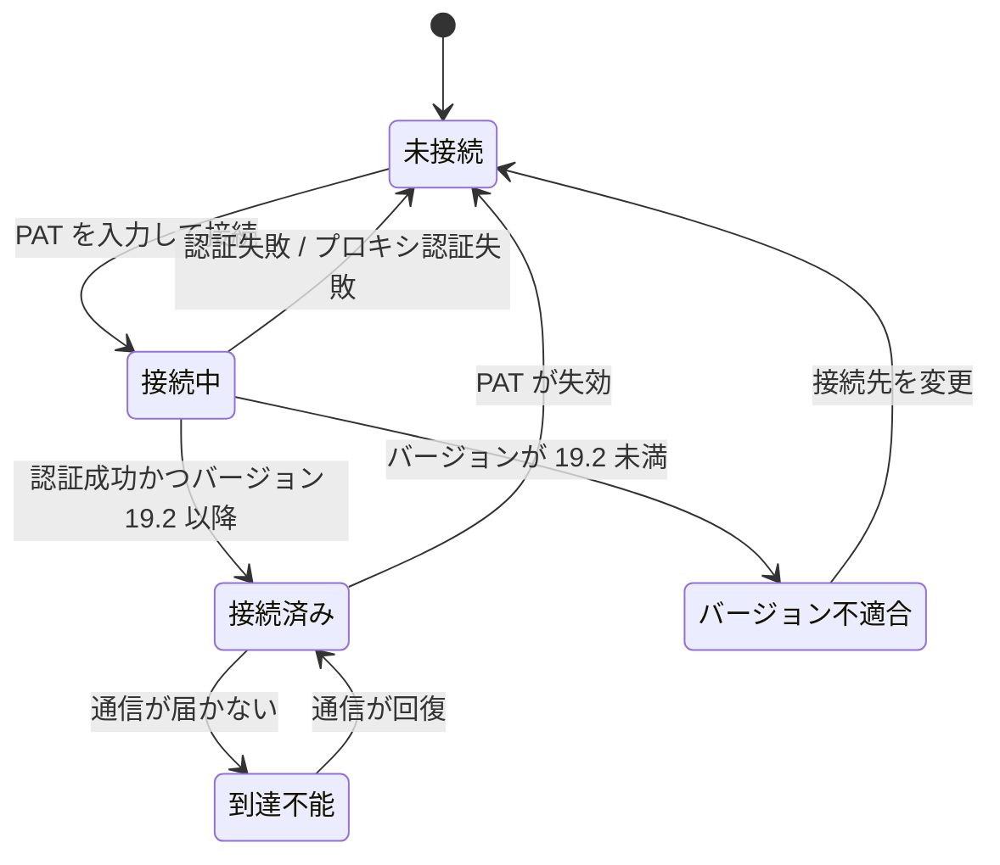

# GitLabRegister 設計書

| 項目 | 内容 |
|---|---|
| バージョン | 0.4 |
| 作成日 | 2026-10-03 |
| 対応する要件書 | docs/requirements.md 版 0.6 |
| ステータス | 承認済み |

## 1. 概要

本書は要件書 `docs/requirements.md` 版 0.6 の全要件 (FR 23 件、NFR 18 件、EC 36 件) を実現する基本設計とアーキテクチャ設計を扱う。
対象は単一の Windows 11 端末で動くデスクトップアプリであり、サーバーコンポーネントは持たない。
画面レイアウトの詳細、関数単位の実装、ライブラリ内部の使い方は実装工程に委ねる。

### 設計判断のステータス

| ADR | 論点 | ステータス |
|---|---|---|
| ADR-01 | 全体構成と UI の実現技術 | 承認済み (2026-10-03) |
| ADR-02 | レイヤ構成と依存の方向 | 承認済み (2026-10-03) |
| ADR-03 | 永続化方式 | 承認済み (2026-10-03) |
| ADR-04 | 登録履歴の書き込み方式 | 承認済み (2026-10-03) |
| ADR-05 | イテレーション設定の実現方式 | 承認済み (2026-10-03) |
| ADR-06 | 日付の表現と基準日の扱い | 承認済み (2026-10-03) |
| ADR-07 | 候補値の取得タイミングとキャッシュ | 承認済み (2026-10-03) |
| ADR-08 | GitLab 通信層の構成 | 承認済み (2026-10-03) |

全 8 件の ADR は 2026-10-03 に依頼者の承認を得た。承認待ちの判断はない。

### 本版で実装から反映した事実

版 0.3 は、コア層とインフラ層の実装で確認できた事実を反映している。
見積もりだった性能は実測値へ、未定義だった記法と形式は定義へ置き換えた。
実装の進捗状況そのものは本書では追わず、`plan.md` に記録する。

| 反映した事実 | 反映先 |
|---|---|
| NFR-01 / NFR-04 の実測値 (展開 1.59 ms、索引構築 10.80 ms) | 第 8.4 節、第 10 節 R-4 |
| 差し込み項目の記法が未定義だった (要件書 FR-15 が設計工程に委ねていた) | 第 4 節 TemplateRenderer |
| 休日の取り込み・書き出し形式が未定義だった | 第 6.3 節 |
| AppSettings と Project は計算に使わないためインフラ層に置いた | 第 5.1 節 |
| 履歴ファイルは人が手編集できるため 1 行の破損を想定する必要がある | 第 5.3 節 |
| 秘密情報のメモリ上の破棄には限界がある | 第 8.3 節 |
| `fs::rename` が Windows でも置き換え先を上書きする | 第 5.3 節 |
| WebView2 のデータフォルダを設定フォルダ配下へ固定できることを実機で確認 | 第 8.3 節、第 10 節 R-1 |
| FR-01 の受け入れ基準 (端末のファイルに PAT が残らない) を実測で確認 | 第 8.3 節 |
| NFR-03 (起動 5 秒以内) と NFR-12 (フォルダ展開のみで起動) を実測 | 第 8.4 節、第 10 節 R-1 |
| 552 行のプレビュー表が仮想化なしで実用になる | 第 10 節 R-6 |
| Tauri の外殻を別の実装単位に分けた | 第 4.1 節 |

## 2. 設計方針

1. **ローカル完結**: サーバーを持たず、端末外への送信先は利用者が指定した GitLab-EE のみとする (NFR-08)。
2. **秘密情報を画面側に置かない**: PAT とプロキシ資格情報は Rust 側の保持器だけが持ち、画面側の状態には残さない。ファイルにも書かない (NFR-05、NFR-17)。
3. **永続データは人が読めるテキスト**: アプリがなくても中身が判別でき、テキストエディタで編集できる形式にする (FR-18、NFR-11)。
4. **計算を副作用のない層に閉じる**: 繰り返し展開、営業日調整、差し込み、重複判定を通信もファイルも触らない層に置き、要件書の受け入れ基準をそのまま単体テストにする (FR-04、FR-05、FR-15、FR-21)。
5. **日付のみを扱い、時刻とタイムゾーンを計算に持ち込まない**: 表示・入力・計算・保存のすべてを日付単位に統一する (NFR-14、EC-24)。

## 3. 主要設計判断 (ADR)

### ADR-01: 全体構成と UI の実現技術 [ステータス: 承認済み]

- **コンテキスト**: 単一利用者の Windows デスクトップアプリを、管理者権限なしでフォルダ展開のみで動かす必要がある (NFR-12)。最大 500 行 × 約 10 列のインライン編集グリッド (FR-07、FR-08) と、表示スケール 100〜200 パーセントへの追従 (NFR-18)、キーボードのみでの操作完結 (NFR-15) を満たす。PAT をどのファイルにも残さない (NFR-05) 制約がある。

- **選択肢**:

  | 案 | 概要 | 利点 | 欠点 |
  |---|---|---|---|
  | A | Tauri 2 + Rust。画面は WebView2 上の Web UI。WebView2 は OS 同梱を前提とする (skip) | 配布が約 10 MB。繰り返しパターンと営業日調整を列挙型の網羅検査でコンパイル時に検証できる。DPI 追従が素直 | ツールチェーンが 3 つ。WebView2 のユーザーデータフォルダと自動入力という封じ込め対象が増える。グリッドの列編集を自前で組む |
  | B | WPF + .NET 自己完結配布 | 外部ランタイム依存ゼロ。DataGrid の列編集と仮想化が標準機能。NFR-05 の対象面がプロセスメモリのみ | 配布が約 70〜80 MB |
  | C | Avalonia UI | 複数 OS に開ける | 要件は Windows 11 専用 (NFR-12) で利得がない。外部 UI フレームワーク依存が増える |

- **決定**: 案 A を採用する。決め手は保守の継続性 (依頼者が Rust で保守する) と、Windows 11 専用化により WebView2 の未導入リスクが消えたこと。
- **却下理由**: 案 B はグリッド工数で有利だが、Windows 11 前提では外部ランタイム依存という最大の差が消え、言語の習熟度が優先した。案 C は複数 OS 対応という利点が要件に存在しないため、依存を増やす理由がない。
- **影響**: WebView2 の封じ込めが必須の設計課題になる (第 8.3 節)。UI と計算処理はプロセス内の境界 (Tauri コマンド) で分かれ、ADR-02 の層構成はこの境界を前提とする。Windows 10 を切る要件変更を要件書 NFR-12 に反映済み。開発端末では WebView2 が導入済みであること (版 154.0.4258.48) を確認したが、フォルダ展開のみでの起動確認は UI 層の着手後に行う (第 10 節 R-1)。

### ADR-02: レイヤ構成と依存の方向 [ステータス: 承認済み]

- **コンテキスト**: FR-04、FR-05、FR-15、FR-21 には実日付入りの受け入れ基準が 30 件以上あり、これを自動検証したい。EC-19 では GitLab-EE に到達できない状態でも展開とプレビューが動く必要がある。

- **選択肢**:

  | 案 | 概要 | テスト容易性 | 複雑さ | 変更容易性 |
  |---|---|---|---|---|
  | A | Rust 側を 3 層に分ける。コア層 (副作用なし) / サービス層 (ユースケース調整) / インフラ層 (ファイル・通信・ログ)。UI は表示と入力のみ | コア層を通信・ファイルなしで単体テストできる | 層が 3 つ | 通信方式の変更がコア層に波及しない |
  | B | Tauri コマンドの中に処理を直接書く 2 層構成 | テストが Tauri ランタイムに依存する | 最小 | 通信とロジックが同じ場所で混ざる |
  | C | 展開ロジックを画面側 (Web UI) に置く | 画面側のテスト基盤が別に必要 | 中 | ADR-01 の決め手である列挙型の網羅検査が使えない |

- **決定**: 案 A。
- **却下理由**: 案 B は受け入れ基準の自動検証がランタイム依存になり、NFR-01 の計測もコマンド経由になって切り分けができない。案 C は ADR-01 で Rust を選んだ理由 (パターンの取りこぼしをコンパイル時に検出する) を失わせ、EC-19 の縮退範囲も画面側に移ってしまう。
- **影響**: 依存の方向はインフラ層・サービス層・UI からコア層への一方向に限る。コア層は日付と定義を入力に取り、結果を返すだけで、ファイルも通信も参照しない。

### ADR-03: 永続化方式 [ステータス: 承認済み]

- **コンテキスト**: 定義・休日カレンダー・登録履歴・設定を端末に保存する。FR-18 は定義ファイルを人が読み、テキストエディタで編集できることを要求する。NFR-11 はフォルダのコピーでバックアップできることを要求する。NFR-04 は履歴 100,000 件を保持した状態で NFR-01 (展開とプレビュー 3 秒以内) と NFR-03 (起動 5 秒以内) を満たすことを要求する。

- **選択肢**:

  | 案 | 概要 | FR-18 の充足 | 依存の重さ | 性能 |
  |---|---|---|---|---|
  | A | すべてテキストファイル。設定・プロジェクト・定義・休日は構造化テキスト、履歴は 1 行 1 件の追記形式 | 内部形式がそのまま人の読める形式 | 外部依存なし | 履歴は起動時にメモリ索引を作って突合 |
  | B | 定義はテキスト、履歴は組み込みデータベース | 履歴の書き出しに変換層が必要 | データベースライブラリが 1 つ増える | 検索と件数の伸びに強い |
  | C | すべて組み込みデータベース | 定義をテキストエディタで編集できず受け入れ基準を満たさない | 同上 | 一貫した問い合わせができる |

- **決定**: 案 A を採用する。決め手は FR-18 の受け入れ基準を変換層なしで満たせること。
- **却下理由**: 案 B は履歴の検索 (FR-19) に強いが、FR-19 は Could 優先度で件数も 100,000 件に収まり、メモリ索引で足りる。変換層と外部依存の追加に見合わない。案 C は FR-18 の受け入れ基準「書き出したファイルをテキストエディタで編集して取り込む」を満たせない。
- **影響**: 履歴の削除 (FR-23) をファイル追記で表現できないため、ADR-04 で書き込み方式を決める。件数上限の根拠は第 8.4 節で示す。

### ADR-04: 登録履歴の書き込み方式 [ステータス: 承認済み]

- **コンテキスト**: EC-08 は一括登録中の強制終了後に「直前までに記録された内容を保持する」ことを求める。EC-10 は通信切断時に登録済み分を履歴に記録することを求める。一方 FR-23 と EC-27 は履歴の個別削除を求め、ADR-03 の追記形式と相反する。

- **選択肢**:

  | 案 | 概要 | EC-08 の充足 | FR-18 の充足 | 複雑さ |
  |---|---|---|---|---|
  | A | 登録成功 1 件ごとに追記する。削除時のみファイル全体を一時ファイルへ書き直して原子的に置き換える | 1 件単位で保持される | 打ち消しレコードがなく読みやすい | 削除が全体書き換え |
  | B | 一括登録の完了後にまとめて書き込む | 強制終了で登録済み分が失われ重複を招く | 同上 | 最小 |
  | C | 追記のみ。削除は打ち消しレコードの追記で表現し、索引構築時に相殺する | 1 件単位で保持される | 打ち消しレコードが混在し人が読んで判断しにくい | 索引構築に相殺処理 |

- **決定**: 案 A。
- **却下理由**: 案 B は EC-08 を満たせない。登録済みの Issue が履歴に残らず、次の展開で再び登録候補に現れて重複を生む。案 C は EC-08 を満たすが、同じ発生日に追加と打ち消しが並ぶファイルになり、FR-18 の「人が読んで判別できる」と EC-27 の確認画面の説明が噛み合わなくなる。
- **影響**: 追記は 1 件ごとにディスクへ確定させる。削除は原子的置換とし、置換の途中で中断しても元のファイルか新しいファイルのどちらかが残るようにする。100,000 件の全体書き換えは第 8.4 節で見積もる。

### ADR-05: イテレーション設定の実現方式 [ステータス: 承認済み]

- **コンテキスト**: 要件書 第 8 節の制約により、GitLab-EE は Issue を作成する操作でイテレーションを受け付けない。FR-06 は「イテレーションの設定だけが失敗した場合、Issue の作成は成功として扱い、イテレーションが未設定であることを結果一覧に表示する」ことを求める。

- **選択肢**:

  | 案 | 概要 | 失敗の検知 | 通信回数 |
  |---|---|---|---|
  | A | Issue を作成したあと、その Issue に対してイテレーションを設定する別操作を行う | 応答で成否を判定できる | 1 件あたり 2 回 |
  | B | 作成時の説明文にイテレーション指定の命令文を埋め込み、GitLab-EE に解釈させる | 失敗しても応答が成功のまま返り検知できない | 1 件あたり 1 回 |
  | C | 案 B を試し、作成後の応答でイテレーションが未設定なら案 A で補う | 検知できる | 1 件あたり 1〜2 回 |

- **決定**: 案 A を採用する。決め手は FR-06 の受け入れ基準が失敗の検知と表示を要求していること。
- **却下理由**: 案 B は通信が半分になるが、設定が失敗しても成功応答が返るため FR-06 の受け入れ基準「イテレーションが未設定であることが併記される」を満たせない。案 C は検知できるが経路が 2 通りになり、テスト対象が倍になる割に削減できる通信は 1 件 1 回にとどまる。
- **影響**: 1 件の登録が 2 回の通信に分かれるため、NFR-02 (100 件を 180 秒以内) の見積もりに織り込む (第 8.4 節)。イテレーション指定のない定義は 1 回の通信で済ませ、無駄な往復を発生させない。

### ADR-06: 日付の表現と基準日の扱い [ステータス: 承認済み]

- **コンテキスト**: NFR-14 は日本標準時のみを対象とする。GitLab-EE の開始日と期限は日付のみを持つ。EC-24 は展開の基準日を実行時点の日付に固定し、表示中のプレビューを日付の変化で再計算しないことを求める。EC-20〜EC-22 は月末・第 N 曜日・閏年の境界を扱う。

- **選択肢**:

  | 案 | 概要 | 境界バグの余地 | テスト容易性 |
  |---|---|---|---|
  | A | 日付のみを持つ型で全計算を行う。現在日付はコア層が自分で取得せず、呼び出し側から引数として渡す | 時刻とタイムゾーンの境界が存在しない | 任意の基準日を渡せるため閏年・月末を直接検証できる |
  | B | 時刻付きのタイムスタンプで保持し、表示時に日本標準時へ変換する | 日付境界の前後で 1 日ずれる余地が残る | 現在時刻の差し替え機構が別に必要 |

- **決定**: 案 A。
- **却下理由**: 案 B は複数タイムゾーンへ広げる余地を残すが、NFR-14 がそれを対象外と定めており、得るものがない。時刻を持つと EC-22 (閏年) と EC-24 (日付の変化) で不要な境界条件が増える。
- **影響**: コア層の関数は現在日付を引数で受け取る。これにより EC-24 の「基準日の固定」が、画面側が一度取得した日付を渡し続けるだけで満たされる。登録履歴に残す登録日時のみ時刻を持たせ、計算には使わない。

### ADR-07: 候補値の取得タイミングとキャッシュ [ステータス: 承認済み]

- **コンテキスト**: FR-16 はラベル・担当者・マイルストーン・エピック・イテレーションの候補を GitLab-EE から取得し、ローカルに保持して次回以降は保持分を初期表示することを求める。EC-19 は到達できない状態で前回取得分と取得日時を表示することを求める。NFR-03 は起動 5 秒以内を求める。

- **選択肢**:

  | 案 | 概要 | 起動時間 | EC-19 の充足 | 通信量 |
  |---|---|---|---|---|
  | A | 選択欄を開いた時に未取得なら取得する。取得結果はファイルに保持し、利用者の操作で再取得する | 影響しない | 前回取得分を表示できる | 使うプロジェクトの分だけ |
  | B | 接続直後に全登録先プロジェクトの候補を一括取得する | プロジェクト数に比例して伸びる | 同上 | 使わないプロジェクトも取得する |
  | C | 毎回取得し、保持しない | 影響しない | 候補を表示できず受け入れ基準を満たさない | 選択欄を開くたびに発生 |

- **決定**: 案 A。
- **却下理由**: 案 B は登録先が増えると NFR-03 を圧迫し、その回に使わないプロジェクトの候補まで取得する。案 C は EC-19 と FR-16 の受け入れ基準「到達できない状態で前回取得した候補が表示される」を満たせない。
- **影響**: 候補の保持データには取得日時を併記し、画面に表示する。候補は機密ではないが担当者名を含むため、保存先は NFR-09 の範囲に置く。

### ADR-08: GitLab 通信層の構成 [ステータス: 承認済み]

- **コンテキスト**: Issue の作成 (FR-06)、プロジェクトの検索 (FR-02)、候補の取得 (FR-16)、イテレーションの設定 (ADR-05)、接続確認 (FR-01)、バージョン判定 (EC-35)、ティア判定 (EC-15) が必要である。再試行 (EC-17)、要求上限 (EC-18)、タイムアウト (EC-16)、プロキシ (NFR-17、EC-34) の規則を一箇所に集めたい。

- **選択肢**:

  | 案 | 概要 | 複雑さ | 規則の重複 |
  |---|---|---|---|
  | A | インフラ層に単一のクライアントを置く。Issue 作成・検索・候補取得は REST、イテレーション設定は GraphQL を使う。接続時にバージョンとライセンスティアを取得して保持する | 2 つの呼び出し方式が混在 | 再試行・タイムアウト・プロキシ・トークンの規則を 1 箇所に集約できる |
  | B | すべて GraphQL で統一する | 呼び出し方式は 1 つ | Issue の作成で項目ごとの組み立てが増え、記述量が膨らむ |
  | C | 操作ごとに独立したクライアントを持つ | 個々は単純 | 再試行・タイムアウト・プロキシの規則が操作ごとに重複する |

- **決定**: 案 A。
- **却下理由**: 案 B は方式を 1 つに揃えられるが、Issue の作成でラベル・担当者・マイルストーン・エピック・ウェイト・機密フラグ・開始日・期限を 1 回で渡せる REST の素直さを失い、得るものがない。案 C は NFR-17 と EC-16〜EC-18 の規則が操作ごとに散らばり、変更時に漏れる。
- **影響**: イテレーション設定だけが GraphQL になるため、その経路のエラー分類を他と同じ形に正規化する (第 6.2 節)。バージョンとティアは接続時に 1 回取得して保持し、以後の画面制御 (EC-15、EC-35) に使う。

## 4. システム構成

### 4.1 層と実装単位の対応

ADR-02 の層は、独立してテストできる単位に分ける。
コア層はファイルも通信も参照しないため、インフラ層を一切使わずに単体テストできる。

| 層 | 実装単位 | 外部への依存 |
|---|---|---|
| コア層 | `gitlabregister-core` | なし (暦計算と直列化の宣言のみ) |
| インフラ層 | `gitlabregister-infra` | ファイル、ネットワーク |
| サービス層・コマンド境界 | `gitlabregister-app` | 上記のみ。GUI を必要としない |
| UI 層 (Tauri の外殻と画面) | `gitlabregister-desktop` | 上記と WebView |

サービス層と UI 層を別の実装単位に分けたのは、試験を GUI のツールチェーンから切り離すためである。
サービス層までの試験は WebView を組み込まずに走り、画面の有無に左右されない。

画面はビルド工程を持たない素の HTML / CSS / JavaScript で書く。
ADR-01 の欠点として挙げた「ツールチェーンが 3 つ」はこれにより 2 つ (Rust と WebView2) になる。

### 4.2 コンポーネントの責務

| コンポーネント | 責務 |
|---|---|
| UI 層 | 画面の描画と入力の受け取り。計算と永続化は行わず、コマンド境界の結果を表示する。PAT は入力後ただちにコマンド境界へ渡し、画面側の状態に残さない |
| コマンド境界 | UI とサービス層の唯一の接点。入力の検証、実行中の多重起動の抑止 (EC-09)、エラーの表示用形式への変換を行う |
| ConnectionService | 接続先 URL と PAT を受け取って接続確認を行い、GitLab-EE のバージョンとライセンスティアを判定して保持する (FR-01、EC-15、EC-35) |
| ScheduleService | 繰り返しタスク定義の作成・編集・複製・削除・有効無効の切り替え・有効期間の設定を扱う (FR-03、FR-14、FR-21) |
| ExpansionService | 指定期間に対して定義を展開し、営業日調整と履歴による除外を適用して登録候補の一覧を組み立てる (FR-07、FR-11) |
| RegistrationService | 登録候補を 1 件ずつ GitLab-EE に登録し、結果を集約して履歴に記録する。失敗分の再実行と単発登録も担う (FR-09、FR-10、FR-12、FR-20) |
| CandidateService | ラベル・担当者・マイルストーン・エピック・イテレーションの候補を取得・保持・再取得する (FR-16) |
| MasterDataService | 登録先プロジェクトと休日カレンダーの管理、および定義・履歴・休日の書き出しと取り込みを扱う (FR-02、FR-13、FR-18、FR-19、FR-22、FR-23) |
| RecurrenceEngine | 繰り返しパターンと有効期間から、指定期間内の発生日の一覧を算出する。副作用を持たず、現在日付は引数で受け取る (FR-04、FR-21、EC-20〜EC-22、EC-30、EC-31)。期間の判定は営業日調整前の発生日に対して行う。調整で期間の外へ出た発生日も残すのは FR-05 の受け入れ基準による。2 週ごと以上で起算日のないパターンは算出 0 件とする (InputValidator が保存時に拒否するが、FR-18 の取り込みで入りうるため算出側にも同じ判断を置く) |
| BusinessDayCalendar | 土日と休日カレンダーから営業日を判定し、発生日に営業日調整を適用する (FR-05、EC-23)。前倒し・後ろ倒しの探索は 366 日を上限とする。FR-05 は上限を定めていないが、休日カレンダーの誤登録で探索が止まらなくなることを防ぐ安全弁である。連続する非営業日が 366 日続くことは暦上ありえないため正常な運用に影響しない |
| DateOffsetCalculator | 営業日調整後の発生日から開始日と期限を算出する (FR-06、EC-36) |
| TemplateRenderer | タイトルと説明の差し込み項目を実際の値へ置き換える (FR-15)。記法は第 4.3 節で定める |
| HistoryIndex | 登録履歴から (定義 ID, 発生日) の索引を構築し、登録済み判定と絞り込みを行う (FR-11、FR-19、FR-23) |
| InputValidator | 定義と単発登録の入力値を検証する。文字数・数値範囲・日付の前後関係を判定する (EC-01〜EC-03、EC-06、EC-36) |
| FileStore | 設定・定義・休日・履歴・候補の読み書き。追記と原子的置換、スキーマ版の判定と読み込み失敗時の退避を担う (ADR-03、ADR-04、EC-28)。履歴ファイルは 1 行が破損しても他の行を読み、破損した行番号を返す (第 5.3 節) |
| GitLabClient | GitLab-EE との通信。再試行・タイムアウト・要求上限・プロキシ・エラー分類を集約する (ADR-08、EC-16〜EC-18、EC-34) |
| SecretHolder | PAT とプロキシ資格情報をプロセスメモリ上でのみ保持し、終了時に破棄する。値は閉包に渡す形でのみ使え、文字列として取り出す経路を持たない (NFR-05、NFR-07)。破棄の限界は第 8.3 節に記す |
| Logger | 操作ログのファイル出力とローテーション。秘密情報の除去を担う (FR-17、NFR-07、NFR-10) |

### 4.3 差し込み項目の記法 (FR-15)

要件書 FR-15 は差し込める 7 つの値を定め、記法を設計工程に委ねている。次のとおり定める。

- 二重波括弧で項目名を囲む。例: `{{発生日}}`
- 項目名は要件書 FR-15 の呼称をそのまま使う
- 二重波括弧で囲まれていない波括弧は文字として扱う
- 閉じのない `{{` 以降はそのまま出力する
- 7 つに含まれない項目名は保存時に拒否する (FR-15)。算出時は置換せずそのまま残し、文字列を失わせない (EC-03)

| 項目名 | 置き換わる値 | 表記 |
|---|---|---|
| `発生日` | 営業日調整後の発生日 | `2026-10-05` |
| `年` | 発生日の年 | `2026` |
| `月` | 発生日の月 | `10` (ゼロ埋めしない) |
| `日` | 発生日の日 | `5` (ゼロ埋めしない) |
| `開始日` | 開始日。未設定なら空文字 | `2026-10-08` |
| `期限` | 期限。未設定なら空文字 | `2026-10-12` |
| `定義名` | 定義の名称 | `月次報告` |

年・月・日をゼロ埋めしないのは、FR-15 の受け入れ基準が発生日 2026-10-05 で
「2026 と 10 に置き換わる」と定めているためである。
日付そのものを差し込む 3 項目はゼロ埋めした `YYYY-MM-DD` とする。

## 5. データ設計

### 5.1 エンティティと関係

エンティティの置き場所は層で分ける。
発生日の算出・検証・重複判定に使う型はコア層に、読み書きの対象でしかない型はインフラ層に置く。
コア層を副作用のない計算だけに保つという ADR-02 の方針に沿う。

| エンティティ | 主な属性 | 備考 |
|---|---|---|
| AppSettings | 接続先 URL、プロキシ設定 (使用区分・ホスト・ポート・資格情報の要否)、スキーマ版 | PAT とプロキシ資格情報は含めない (NFR-05)。計算に使わないためインフラ層に置く |
| Project | プロジェクト識別子、表示名 | GitLab-EE 上の識別子を保持する (FR-02)。計算に使わないためインフラ層に置く |
| Schedule | 定義 ID、名称、登録先プロジェクト、有効フラグ、有効期間 (開始・終了)、繰り返しパターン、Issue テンプレート | 定義 ID は不変。名称は一意 (FR-03) |
| RecurrencePattern | 種別 (7 種)、曜日集合、日付、第 N 週、間隔 N、起算日、月末の扱い、営業日調整の種別 | 種別は列挙。種別ごとに意味を持つ属性のみを埋める (FR-04、FR-05) |
| IssueTemplate | タイトル、説明、ラベル集合、担当者集合、マイルストーン、開始日オフセット、期限オフセット、機密フラグ、エピック、イテレーション、ウェイト | 開始日と期限はオフセット。未指定を表せる (FR-06) |
| Holiday | 日付、名称 | 日付が一意 (FR-13、EC-04) |
| HistoryEntry | 定義 ID、定義名、発生日、登録日時、登録先プロジェクト、作成された Issue の識別情報 | 定義名を非正規化して持つ。定義を削除しても履歴から名称が読める (EC-26) |
| CandidateCache | プロジェクト識別子、種別、候補の一覧、取得日時 | 取得日時を画面に表示する (FR-16、EC-19) |

### 5.2 重複判定のキー

登録済み判定のキーは (定義 ID, 営業日調整後の発生日) とする (FR-11)。
定義 ID は不変であるため、定義の名称やパターンを変更しても過去の履歴との対応は保たれる (EC-30)。
定義を削除して同じ名称で作り直した場合は定義 ID が変わるため、過去の履歴による除外は働かない。この挙動は EC-26 の「履歴は残して閲覧できる」と矛盾しない。

### 5.3 ファイルレイアウトと永続化方針

保存先は実行する利用者の Windows ユーザープロファイル配下の 1 つのフォルダとする (NFR-09、NFR-11)。

| ファイル | 内容 | 書き込み方式 |
|---|---|---|
| 設定ファイル | AppSettings | 全体置換 |
| プロジェクトファイル | Project の一覧 | 全体置換 |
| 定義ファイル | Schedule の一覧 | 全体置換 |
| 休日ファイル | Holiday の一覧 | 全体置換 |
| 履歴ファイル | HistoryEntry の一覧 (1 行 1 件) | 登録成功ごとに追記。削除時のみ原子的置換 (ADR-04) |
| 候補ファイル | CandidateCache | 全体置換 |
| 実行中の印 | 一括登録の開始時刻と予定件数 | 開始時に作成し、正常終了時に削除 (EC-08、第 7.2 節) |
| ログファイル | 操作ログ | 追記とローテーション (NFR-10) |

全体置換と原子的置換は、一時ファイルへ書き切ってから本来の名前へ置き換える。
一時ファイルは置き換え先と同じフォルダに作る。別のフォルダに作ると名前の置き換えが
フォルダ間の移動になり、原子性が失われる。
置き換えの途中で中断しても、元のファイルか新しいファイルのどちらかが完全な状態で残る。
Windows の名前の置き換えが既存のファイルを上書きすることは実測で確認した。

文書ファイルは整形して書き出す。アプリを使わずに人が読み、テキストエディタで
編集できるようにするためである (FR-18)。

### 5.3.1 手編集による破損への備え

FR-18 により、利用者はファイルをテキストエディタで編集できる。
このため形式の破損が起こりうる。ファイルの種類によって扱いを分ける。

| 対象 | 破損したときの扱い |
|---|---|
| 設定・プロジェクト・定義・休日 (1 ファイル 1 文書) | 1 件も反映せず失敗を返す。部分的に壊れた定義を使うより、読み込まないほうが安全である |
| 履歴 (1 行 1 件) | 解釈できた行のみを読み、破損した行の行番号を返す。1 行の破損で全履歴を失わせない。空行は破損として数えない |

### 5.4 スキーマ版と移行

各ファイルの先頭にスキーマ版を持たせる (EC-28)。
読み込み時に版を判定し、アプリが扱える版より新しい場合と、読み込みに失敗した場合は、処理前に作成したフォルダの複製を残して復元手順を画面に表示する。
版が古い場合は現行版へ変換して読み込む。

## 6. インターフェース設計

### 6.1 UI とサービス層の境界 (コマンド境界)

すべての呼び出しは、成功時は結果、失敗時は下表の分類と表示用メッセージを返す。
UI 層はこの分類だけを見て表示を切り替え、分類の判定を自分で行わない。

| 主な操作 | 入力 | 出力 | 失敗時の扱い |
|---|---|---|---|
| 接続する | 接続先 URL、PAT、プロキシ資格情報 (必要時) | 認証された利用者名、GitLab-EE のバージョン、ライセンスティア | 認証失敗・到達不能・バージョン下限未満・プロキシ認証失敗を区別して返す (EC-11、EC-16、EC-34、EC-35) |
| 定義を保存する | Schedule | 保存後の Schedule | 検証エラーは違反した項目名と理由の一覧を返す (EC-01〜EC-03、EC-06、EC-36) |
| 展開する | 期間 (開始日・終了日)、基準日 | 登録候補の一覧、除外された発生日の一覧、警告の一覧 | 期間の逆転、上限件数超過を区別して返す (FR-07、EC-05) |
| 一括登録する | 登録候補の一覧 (選択済み) | 進捗の通知と、件ごとの結果 | 件ごとに成功・失敗を返し、全体は失敗にしない (FR-09、FR-10) |
| 一括登録を中止する | なし | 登録済み件数、未登録件数 | — |
| 単発登録する | Issue の入力値、登録先 | 作成された Issue の識別情報 | 入力値を保持したまま失敗理由を返す (FR-12) |
| 履歴を削除する | 対象の記録の一覧 | 削除件数 | — |
| 候補を取得する | プロジェクト識別子、種別、再取得の指定 | 候補の一覧、取得日時、鮮度の区分 | 到達不能時は保持分と取得日時を返す (FR-16、EC-19) |

進捗の通知は、コマンドの戻り値ではなく UI 層への逐次通知で行う。
1 件の処理が完了するたびに、処理済み件数と全件数を通知する (FR-09)。

### 6.2 GitLab-EE との境界

| 操作 | 用途 | 方式 |
|---|---|---|
| 認証利用者の取得 | 接続確認、利用者名の表示 (FR-01) | REST |
| インスタンス情報の取得 | バージョン判定 (EC-35)、ライセンスティア判定 (EC-15) | REST |
| プロジェクトの検索・取得 | 登録先の登録 (FR-02)、削除・アーカイブの検出 (EC-29) | REST |
| ラベル・メンバー・マイルストーン・エピック・イテレーションの一覧取得 | 候補の取得 (FR-16) | REST |
| Issue の作成 | 登録 (FR-06、FR-09、FR-12) | REST |
| Issue へのイテレーション設定 | ADR-05 の第 2 操作 | GraphQL |

GitLabClient は応答を次の分類へ正規化する。方式の違い (REST と GraphQL) は分類に現れない。

| 分類 | 判定の契機 | 既定の振る舞い |
|---|---|---|
| 認証エラー | 認証が拒否された | 再試行しない。PAT の再入力を求める (EC-11) |
| 認可エラー | 操作が許可されていない | 再試行しない。該当件を失敗とし他の件は続行する (EC-12) |
| 入力エラー | 値が受け付けられなかった | 再試行しない。項目名と理由を失敗理由に載せる (EC-13、EC-14、EC-33) |
| 対象不在 | 対象が見つからない | 再試行しない (EC-29) |
| 要求上限 | 要求数の上限超過が示された | 待機時間の指示があればその時間、なければ 60 秒待って 1 回再試行する (EC-18) |
| 一時エラー | サーバー側エラー | 2 秒後と 4 秒後に最大 2 回再試行する (EC-17) |
| 到達不能 | 接続できない、30 秒で応答がない | 一括登録中は処理を止める (EC-10、EC-16) |
| プロキシ認証エラー | プロキシが認証を拒否した | 再試行しない。プロキシ設定の見直しを案内する (EC-34) |

### 6.3 ファイルの取り込み境界

#### 休日カレンダー (FR-22、EC-04)

要件書と本書の前版は形式を定めていなかった。次のとおり定める。

- 1 行 1 件。形式は `YYYY-MM-DD,名称`
- 名称は省略できる
- 先頭が `#` の行は注記、空行は読み飛ばす

行単位にするのは、FR-22 の受け入れ基準が「解釈できなかった行の行番号を一覧表示する」を
求めており、行と記録が 1 対 1 でないと行番号を示せないためである。

取り込みは解釈できた行のみを登録し、次の 2 つを区別して返す。

- 日付として解釈できなかった行の行番号
- 同一日付が重複していた行の行番号。最初の 1 件のみを登録する (EC-04)。既存の休日と同じ日付も重複として扱う

書き出しは対象が 0 件のとき実行せず、0 件であることを返す (FR-22)。

#### 定義と履歴 (FR-18)

定義の取り込みは、同一名称の既存定義に対する扱い (上書き・取り込まない) を入力として受け取る。
返す内容は、追加した件数、置き換えた件数、取り込まなかった定義名の一覧とする。
形式そのものが解釈できない場合は、1 件も反映せずに失敗を返す。

## 7. 主要フロー

### 7.1 正常系: 期間指定から一括登録まで

対応要件: FR-01、FR-07、FR-08、FR-09、FR-10、FR-11

### 7.2 異常系: 一括登録の中断と履歴の整合

対応要件: EC-08、EC-10、ADR-04

通信切断を検知すると、RegistrationService はその時点で処理を止める。
中断前に成功した分は 1 件ごとに履歴へ追記済みであるため、履歴と GitLab-EE の状態は一致する。
強制終了や電源断の場合も、追記済みの分までは保持される。

ただし「Issue の作成に成功した直後、履歴への追記前に落ちた」場合は、GitLab-EE 上に Issue があって履歴にない状態が残る。
この 1 件は次の展開で再び登録候補に現れる。
これを利用者に知らせるため、一括登録の開始時に実行中であることを示す印をファイルへ残し、正常終了時に消す。
次回起動時に印が残っていれば、前回の一括登録が中断されたことと GitLab-EE 上の重複確認を促す警告をプレビューに表示する (EC-08)。

### 7.3 異常系: イテレーション設定のみの失敗

対応要件: FR-06、ADR-05

履歴への追記は Issue の作成が成功した時点で行う。
イテレーションの設定結果は履歴の有無に影響しない。
これにより、再実行でイテレーションだけを設定し直す操作が、重複した Issue を生まない。

### 7.4 異常系: 未登録ラベルの警告

対応要件: EC-32、FR-16

展開時に、定義のラベル名を候補の保持データと突合する。
候補にない名称があれば、プレビューの該当行に未登録のラベル名を警告として表示する。
利用者が警告を承知して実行した場合に限り登録する。
候補が未取得のプロジェクトでは突合できないため、突合できなかったことを警告として区別して表示する。

### 7.5 接続状態の遷移

対応要件: FR-01、EC-11、EC-19、EC-35

| 状態 | 可能な操作 |
|---|---|
| 未接続 | 定義・休日・プロジェクト・履歴の閲覧と編集、展開とプレビュー |
| 接続済み | 上記に加えて一括登録、単発登録、候補の取得 |
| 到達不能 | 未接続と同じ範囲。候補は保持分を表示する (EC-19) |
| バージョン不適合 | 未接続と同じ範囲。登録は実行しない (EC-35) |

## 8. 横断的関心事

### 8.1 エラー処理方針

分類は第 6.2 節の 8 分類に統一する。
一括登録では件単位で分類を判定し、再試行しない分類は即座に失敗として記録して次の件へ進む (FR-09)。
全体を失敗にする分類は「到達不能」と「認証エラー」の 2 つに限る (EC-10、EC-11)。

失敗の表示には、失敗した対象 (定義名と発生日)、失敗の理由、利用者が次に取れる操作の 3 つを必ず含める (NFR-16)。
次に取れる操作は分類から導く。入力エラーなら該当項目の修正と再実行、認可エラーなら登録先または担当者の変更、到達不能なら接続の確認である。

### 8.2 ログ

Logger は接続、展開、一括登録、件ごとの成功と失敗、設定の変更を記録する (FR-17)。
記録する項目は日時、操作の種別、対象の識別情報 (定義名・発生日・プロジェクト)、結果である。

秘密情報の除去は Logger の内部で行う。
PAT とプロキシのパスワードは SecretHolder だけが保持し、Logger へ渡る経路を持たない。
GitLab-EE の応答に認証情報が含まれる場合も、ログへ書く前に除去する (NFR-07)。
1 ファイル 10 MB で切り替え、5 世代を保持し、6 世代目以降は古いものから削除する (NFR-10)。

### 8.3 セキュリティ

**PAT とプロキシ資格情報の扱い** (NFR-05、NFR-17):

- 画面の入力欄は伏せ字とし、入力値はコマンド境界へ渡した後に画面側の状態から消す。
- SecretHolder はプロセスメモリ上でのみ保持し、終了時に破棄する。値は閉包に渡す形でのみ使え、文字列として取り出す経路を持たない。供給先は GitLabClient に限る。
- 設定・定義・休日・履歴・候補・ログのいずれにも書かない。FR-01 の受け入れ基準 (端末全文検索で一致 0 件) はこの方針で満たす。
- SecretHolder の表示 (デバッグ出力を含む) に値を含めない。設定済みか未設定かだけを示す。

**メモリ上の破棄の限界**: SecretHolder は破棄時に保持している文字列を 0 で埋めるが、
これは最善努力であり次の 2 点は保証できない。

- 値が SecretHolder へ渡る前に作られた複製 (画面からの受け渡しの途中で生じるもの)
- OS がメモリをページファイルへ書き出した場合

FR-01 の受け入れ基準を満たすのは「アプリがファイルへ書かない」という方針であり、
0 埋めはそれをさらに狭めるための措置である。要件を満たす根拠をこの措置に置かない。

**WebView2 の封じ込め** (ADR-01 の影響、NFR-05、NFR-09):

ADR-01 で WebView を使うため、既定では端末にブラウザのデータが書かれる。次の 3 点で閉じる。

1. 起動時、WebView を初期化する前に、WebView2 のユーザーデータフォルダを設定フォルダ配下へ固定する。これは環境変数による指定が実装側の値を上書きするため、アプリ自身が起動の最初に設定する。**実機で確認済み**: 起動すると設定フォルダ配下にブラウザのデータが作られ、実行ファイルの隣や OS の既定の場所には作られない (NFR-09)。
2. PAT の入力欄を伏せ字にし、自動入力と綴り確認を切る。WebView2 の設定を直接触る経路は使わず、画面の記述でこれを行う。
3. 画面側は PAT を保持しない。入力欄から受け取った値はコマンド境界へ渡した直後に欄を空にする。

**FR-01 の受け入れ基準の確認**: 見分けのつくトークンで接続を試み (到達できない URL を使うため通信は失敗する)、
設定フォルダ全体 (WebView2 のデータを含む 167 ファイル、8.7 MB) をそのトークン文字列で全文検索した。
一致は 0 件である。対照として接続先 URL で検索すると 3 件が見つかり、検索そのものが機能していることを確かめた。

**ログの秘密情報の除去** (NFR-07):

ログへ出す前に次の 2 段で伏せる。SecretHolder から Logger へ値が渡る経路は作らず、
伏せる対象の文字列だけを受け取る。

1. 保持している値そのものとの一致。長い文字列から順に置き換え、短い文字列が長い文字列の一部である場合の取りこぼしを防ぐ
2. トークンに使われる前置詞と認証ヘッダーの形との一致。GitLab-EE の応答に別のトークンが含まれて渡された場合に備える二重の防御である

**通信** (NFR-06、NFR-08):

HTTPS のみを用いる。サーバー証明書の検証を無効化する設定項目を持たない。
社内の証明機関を使う環境では OS の証明書ストアに従う。
送信先は AppSettings の接続先とプロキシに限り、利用統計と障害情報の外部送信を行わない。

### 8.4 性能対策

| 要件 | 実現方式 | 状況 |
|---|---|---|
| NFR-01 (定義 50 件・期間 92 日の展開とプレビュー表示を 3 秒以内、通信を含まない) | 展開はコア層の計算のみで通信を伴わない。発生日の算出は期間の日数に比例する。履歴の除外は索引による定数時間の判定とする | **実測 1.59 ms** (定義 50 件・92 日・休日 1,000 件・履歴 100,000 件。除外 191 件、候補 1,067 件) |
| NFR-02 (100 件の一括登録を 180 秒以内。1 件あたりの応答が 1 秒以内の条件) | ADR-05 によりイテレーション指定のある件は 2 通信になる。全件がイテレーション指定を持つ最悪の場合で 200 通信、1 通信 1 秒として 200 秒となり要件を超える。このため登録は逐次ではなく、同時実行数を 2 として進める。同時実行数 2 で最悪 100 秒となり要件を満たす | **未実測**。通信層が未実装。第 10 節 R-2 |
| NFR-03 (起動から接続画面の操作まで 5 秒以内) | 起動時に読み込むのは設定・プロジェクト・定義・休日に限る。履歴は最初の展開時まで読み込まない。候補は選択欄を開くまで読み込まない (ADR-07) | **実測 428 ms** (初回) / **70 ms** (2 回目以降)。配布形態の実行ファイルを 3 回計測 |
| NFR-04 (定義 200 件・休日 1,000 件・履歴 100,000 件の保持下で NFR-01 と NFR-03 を満たす) | 履歴 100,000 件の索引は (定義 ID, 発生日) の集合である。構築は最初の展開時に 1 回行う。1 回の一括登録で選択できる上限 500 件は ExpansionService が判定する (EC-05) | **実測 4.58 ms** (定義 200 件)。索引構築は **10.80 ms** (一意キー 100,000 件) |

同時実行数を 2 とする判断は NFR-02 から導いた設計上の値であり、要件書には現れない。
実測が見積もりと異なる場合は第 10 節 R-2 の検証で見直す。

履歴の索引構築 (10.80 ms) と展開 (1.59 ms) を合わせて約 12.4 ms であり、
NFR-01 の 3 秒に対して 240 倍の余裕がある。
このため索引を永続化する必要はないと判断した (前版の未解決事項 2 を解消)。

## 9. トレーサビリティ表

| 要件 ID | 対応する節/設計要素 | 備考 |
|---|---|---|
| FR-01 | 6.1 接続する、7.5 接続状態の遷移、8.3 PAT の扱い、ADR-08 | — |
| FR-02 | 4.2 MasterDataService、5.1 Project、6.2 プロジェクトの検索 | — |
| FR-03 | 4.2 ScheduleService、5.1 Schedule、6.1 定義を保存する | — |
| FR-04 | 4.2 RecurrenceEngine、ADR-02、ADR-06 | 受け入れ基準をコア層の単体テストで検証 |
| FR-05 | 4.2 BusinessDayCalendar | — |
| FR-06 | 4.2 DateOffsetCalculator、5.1 IssueTemplate、7.3、ADR-05 | — |
| FR-07 | 4.2 ExpansionService、6.1 展開する、7.1 | — |
| FR-08 | 4.2 UI 層、7.1 | 登録候補は永続化しない |
| FR-09 | 4.2 RegistrationService、6.1 一括登録する、7.1 | 進捗は逐次通知 |
| FR-10 | 4.2 RegistrationService、6.1、8.1 | — |
| FR-11 | 4.2 HistoryIndex、5.2 重複判定のキー、ADR-04 | — |
| FR-12 | 4.2 RegistrationService、6.1 単発登録する | 履歴に記録しない |
| FR-13 | 4.2 MasterDataService、5.1 Holiday、4.2 BusinessDayCalendar | — |
| FR-14 | 4.2 ScheduleService、5.1 Schedule 有効フラグ | — |
| FR-15 | 4.2 TemplateRenderer、4.3 差し込み項目の記法 | 記法を本版で定義 |
| FR-16 | 4.2 CandidateService、5.1 CandidateCache、ADR-07、7.4 | — |
| FR-17 | 8.2 ログ | — |
| FR-18 | ADR-03、5.3 ファイルレイアウト、5.3.1 手編集への備え、6.3 定義と履歴 | 内部形式が人の読める形式 |
| FR-19 | 4.2 HistoryIndex、5.1 HistoryEntry | 定義名を非正規化して保持 |
| FR-20 | 4.2 RegistrationService、7.3、8.1 | — |
| FR-21 | 4.2 RecurrenceEngine、5.1 Schedule 有効期間 | — |
| FR-22 | 4.2 MasterDataService、4.2 FileStore、6.3 休日カレンダー | 形式を本版で定義 |
| FR-23 | 4.2 HistoryIndex、ADR-04 削除時の原子的置換 | — |
| NFR-01 | 8.4 性能対策 | 実測 1.59 ms |
| NFR-02 | 8.4 性能対策、ADR-05 | 同時実行数 2 で達成 |
| NFR-03 | 8.4 性能対策、ADR-07 | 履歴と候補を遅延読み込み |
| NFR-04 | 8.4 性能対策、ADR-04 | 実測 4.58 ms / 索引構築 10.80 ms |
| NFR-05 | 4.2 SecretHolder、8.3 PAT の扱いと破棄の限界、8.3 WebView2 の封じ込め | 破棄の限界は R-7 |
| NFR-06 | 8.3 通信 | — |
| NFR-07 | 4.2 SecretHolder、8.2 ログ、8.3 ログの秘密情報の除去 | — |
| NFR-08 | 2 設計方針 1、8.3 通信 | — |
| NFR-09 | 5.3 ファイルレイアウト、8.3 WebView2 の封じ込め | — |
| NFR-10 | 8.2 ログ | — |
| NFR-11 | 5.3 ファイルレイアウト、ADR-03 | — |
| NFR-12 | ADR-01、10 リスク R-1 | WebView2 は OS 同梱を前提 |
| NFR-13 | ADR-08、4.2 ConnectionService、7.5 | — |
| NFR-14 | ADR-06 | — |
| NFR-15 | 4.2 UI 層 | 実装工程で操作順序を確認 |
| NFR-16 | 8.1 エラー処理方針、6.1 | — |
| NFR-17 | 4.2 GitLabClient、8.3 PAT の扱い、6.2 プロキシ認証エラー | — |
| NFR-18 | 4.2 UI 層、ADR-01 | WebView の表示追従で満たす |
| EC-01 | 4.2 InputValidator、6.1 定義を保存する | — |
| EC-02 | 4.2 InputValidator、6.1 | 文字数はコードポイント数で判定 |
| EC-03 | 4.2 InputValidator、6.2 Issue の作成 | 文字列を変換せず渡す |
| EC-04 | 4.2 FileStore、6.3 休日カレンダー | — |
| EC-05 | 4.2 ExpansionService、6.1 展開する、8.4 | — |
| EC-06 | 4.2 InputValidator | — |
| EC-07 | 4.2 UI 層、6.1 展開する | 定義 0 件で展開を実行しない |
| EC-08 | 7.2 中断と履歴の整合、ADR-04、5.3 実行中の印 | 実行中の印で検知 |
| EC-09 | 4.2 コマンド境界 | 実行中は開始操作を受け付けない |
| EC-10 | 7.2、6.2 到達不能、8.1 | — |
| EC-11 | 7.5 接続状態の遷移、6.2 認証エラー、8.1 | — |
| EC-12 | 6.2 認可エラー、8.1 | — |
| EC-13 | 6.2 入力エラー、8.1 | — |
| EC-14 | 6.2 入力エラー、8.1 | EC-13 と同じ分類 |
| EC-15 | 4.2 ConnectionService、ADR-08 ティア判定 | — |
| EC-16 | 6.2 到達不能、8.1 | タイムアウト 30 秒 |
| EC-17 | 6.2 一時エラー | 2 秒・4 秒で 2 回 |
| EC-18 | 6.2 要求上限、8.4 同時実行数 | — |
| EC-19 | 7.5 接続状態の遷移、ADR-07、ADR-02 層分離 | — |
| EC-20 | 4.2 RecurrenceEngine、5.1 月末の扱い | — |
| EC-21 | 4.2 RecurrenceEngine | — |
| EC-22 | 4.2 RecurrenceEngine、ADR-06 | — |
| EC-23 | 4.2 BusinessDayCalendar | — |
| EC-24 | ADR-06 基準日の注入 | — |
| EC-25 | ADR-06、2 設計方針 5 | 該当なしの要件。多言語対応を設計に持ち込まない |
| EC-26 | 5.1 HistoryEntry、5.2 重複判定のキー | 定義名を非正規化 |
| EC-27 | ADR-04 削除時の原子的置換 | — |
| EC-28 | 5.4 スキーマ版と移行、5.3.1 手編集への備え | — |
| EC-29 | 6.2 対象不在、8.1 | — |
| EC-30 | 4.2 RecurrenceEngine、5.2 重複判定のキー | 定義 ID が不変 |
| EC-31 | 4.2 RecurrenceEngine | — |
| EC-32 | 7.4 未登録ラベルの警告、4.2 CandidateService | — |
| EC-33 | 6.2 入力エラー | 名称は大文字小文字を区別 |
| EC-34 | 6.2 プロキシ認証エラー、8.3 | — |
| EC-35 | 4.2 ConnectionService、7.5、ADR-08 | — |
| EC-36 | 4.2 InputValidator、4.2 DateOffsetCalculator | — |

全 77 件が対応済み。未解決事項へ送った要件はない。

実装の進捗 (どの要件がコードとして存在するか) は本書では追わず、`plan.md` の
受け入れ基準対応表に記録する。本表は要件と設計要素の対応のみを示す。

## 10. リスクと検証方法

| # | リスク | 内容 | 検証方法 |
|---|---|---|---|
| R-1 | WebView2 の前提 (**解消**) | ADR-01 は WebView2 が OS に同梱されていることを前提とする。要件書 NFR-12 を Windows 11 専用に狭めてこの前提を担保した。将来 Windows 10 端末での利用要望が出た場合は配布方式の見直しが必要になる | 配布形態の実行ファイル 1 つ (14.4 MB) を空のフォルダへ複製して起動した。インストーラなし、管理者権限なし、WebView2 の明示的な導入なしで窓が開き、画面が操作できることを確認した (NFR-12) |
| R-2 | NFR-02 の同時実行数 | 同時実行数 2 という値は 1 通信 1 秒という仮定からの机上計算である。実際の応答時間が遅い場合、または同時実行が要求上限 (EC-18) を誘発する場合は満たせない | 実インスタンスに対し 100 件の登録を計測する。要求上限の応答が出るかを確認し、出る場合は同時実行数を 1 に戻して所要時間を再評価する |
| R-3 | イテレーション設定の方式 | ADR-05 の第 2 操作は GraphQL を用いる。この経路のエラー分類が REST と同じ形に正規化できるかは未検証である | 存在しないイテレーション、権限のないイテレーションを指定して応答を確認し、第 6.2 節の 8 分類に落ちることを確認する |
| R-4 | 履歴 100,000 件の読み込み (**解消**) | 索引構築が NFR-01 の 3 秒に収まるかが未検証だった | 一意キー 100,000 件の履歴で計測し、索引構築 10.80 ms、展開 1.59 ms を確認した。索引の永続化は不要と判断した (第 8.4 節) |
| R-5 | ライセンスティアの判定方法 | EC-15 はティアに応じて EE 固有項目の入力を閉じることを求める。接続時にティアを判定できるかは未検証である | 実インスタンスで取得できる情報を確認する。判定できない場合は、EE 固有項目の登録失敗を検知してから閉じる方式に変更する |
| R-6 | 500 行のインライン編集 (**解消**) | 10 列 × 500 行の編集で操作が重くならないかが未検証だった | 定義 6 件 × 92 日 = **552 行**を仮想化なしで描画し、編集欄・固定見出し・スクロールが成立することを確認した。描画は 1 秒未満で完了する。仮想化は入れない |
| R-7 | 秘密情報のメモリ上の残存 | SecretHolder の 0 埋めは最善努力であり、受け渡しの途中で作られた複製と、OS がページファイルへ書き出した場合は制御できない (第 8.3 節) | ファイルに残らないことは第 8.3 節のとおり実測で確認した。メモリ上の残存は検証では解消できない性質のものであり、残る |
| R-8 | 実インスタンスに対する未検証の項目 | R-2 (同時実行数 2)、R-3 (イテレーション設定のエラー分類)、R-5 (ライセンスティアの判定) は、組織の GitLab-EE に接続しないと確認できない | 実インスタンスで接続し、100 件の登録の計測、イテレーション設定の応答、ライセンス情報の取得可否を確認する |

## 11. 未解決事項

| # | 論点 | 決定に必要な情報 | 決定者 |
|---|---|---|---|
| 1 | 第 8.4 節の同時実行数 2 の妥当性 | R-2 の計測結果。実インスタンスに対する 100 件の登録が必要 | 依頼者 (計測後) |
| 2 | ライセンスティアの判定方法 | R-5 の確認結果。接続時に判定できない場合、EC-15 を登録失敗の検知後に閉じる方式へ変更する | 依頼者 (確認後) |
| 3 | イテレーション設定のエラー分類 | R-3 の確認結果。第 6.2 節の 8 分類に落ちない応答があれば分類を追加する | 依頼者 (確認後) |

前版の未解決事項 2 (履歴索引の永続化) は第 8.4 節の実測により解消した。

## 12. 変更履歴

| 日付 | 版 | 変更内容 |
|---|---|---|
| 2026-10-03 | 0.1 | 初版作成。要件書 版 0.6 の全 77 要件に対応。ADR-01、ADR-03、ADR-05 は依頼者の承認済み |
| 2026-10-03 | 0.2 | ADR-02、ADR-04、ADR-06、ADR-07、ADR-08 の承認を得て全 8 件を承認済みに変更。ステータスを承認済みへ。未解決事項から承認待ちの行を削除し、R-5 由来の論点を追加 |
| 2026-10-03 | 0.4 | UI 層の実装で確認した事実を反映。NFR-03 / NFR-12 を実測値に、R-1 と R-6 を解消。FR-01 の受け入れ基準の確認方法と結果を第 8.3 節に追加。第 4.1 節の実装単位を 4 つに分け、画面がビルド工程を持たないことを明記。R-8 (実インスタンス待ちの項目) を追加 |
| 2026-10-03 | 0.3 | コア層とインフラ層の実装で確認した事実を反映。差し込み項目の記法 (第 4.3 節) と休日の取り込み形式 (第 6.3 節) を定義。NFR-01 / NFR-04 を実測値に置き換え、R-4 を解消して未解決事項 2 を削除。層と実装単位の対応 (第 4.1 節)、手編集による破損への備え (第 5.3.1 節)、秘密情報の破棄の限界 (第 8.3 節、R-7) を追加。AppSettings と Project の置き場所をインフラ層に修正 |
