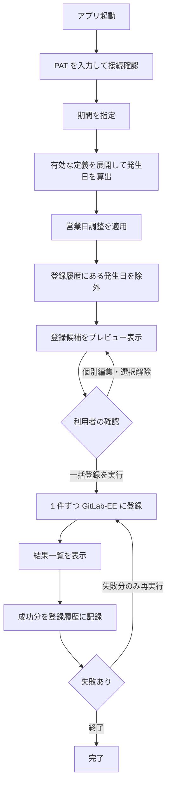

# GitLab-EE 繰り返し Issue 登録アプリ (仮称: GitLabRegister) 要件定義書

| 項目 | 内容 |
| --- | --- |
| バージョン | 0.6 (draft) |
| 作成日 | 2026-10-03 |
| ステータス | ドラフト |

## 1. 背景と目的

日次・週次・月次で必ず発生する作業がある。
たとえば週次の進捗報告、月次の棚卸し、四半期ごとの棚卸し確認である。
これらは GitLab-EE の Issue として管理したいが、現状は人が毎回 Web 画面を開いて同じ内容を手で起票している。
その結果、起票そのものに時間がかかり、忙しい週には起票漏れが起きる。

このアプリを導入した後は、繰り返し発生する作業を一度「繰り返しタスク定義」として登録しておき、作業計画を立てるタイミングで期間を指定して該当分の Issue をまとめて起票できる。
利用者が確認するのは展開結果のプレビューだけになり、1 件ずつ Web 画面で入力する作業がなくなる。
登録済みの発生日は履歴から除外されるため、同じ期間を二度登録しても Issue が重複しない。

## 2. 用語定義

| 用語 | 定義 |
| --- | --- |
| GitLab-EE | 組織内で運用している GitLab Enterprise Edition のインスタンス。本アプリの連携先 |
| 繰り返しタスク定義 | 繰り返しパターンと Issue の内容をひとまとめにした設定。以下「定義」 |
| 繰り返しパターン | 定義がいつ発生するかを表す規則。FR-04 に列挙した 7 種類を指す |
| 発生日 | 繰り返しパターンから算出される、その回の基準となる日付 |
| 起算日 | N 日ごと・N 週ごとのパターンで、繰り返しの周期を数え始める基準日。隔週の発生週はこの日付だけで決まる |
| 開始日 | Issue の作業開始予定日として GitLab-EE に登録する日付。発生日からの日数オフセットで算出する。発生日とは別の値である |
| 展開 | 指定した期間に対して定義の繰り返しパターンを適用し、発生日の一覧を算出すること |
| 登録候補 | 展開結果の各発生日に対して生成された、未登録の Issue 1 件分のデータ |
| プレビュー | 一括登録を実行する前に、登録候補の一覧を利用者に提示する画面 |
| 登録履歴 | どの定義のどの発生日を GitLab-EE に登録済みかを端末に記録したもの |
| 休日カレンダー | 土日以外の非営業日 (国民の祝日、会社の休業日) の日付を登録したもの |
| 営業日 | 土曜・日曜のいずれでもなく、かつ休日カレンダーに登録されていない日 |
| 営業日調整 | 発生日が営業日でない場合に、発生日を前後の営業日へ移動するか、その回を飛ばす処理 |
| EE 固有項目 | GitLab の有償ライセンスティアでのみ利用できる Issue 項目。エピック、イテレーション、ウェイト、複数担当者を指す |
| 単発登録 | 定義を使わず、利用者がその場で入力した内容で Issue を 1 件登録すること |

## 3. 前提と仮定

### 前提

- 連携先は組織内で運用する GitLab-EE インスタンスである。
- 利用者は GitLab-EE のアカウントを持ち、登録先プロジェクトに対して Issue を作成する権限を持つ。
- 利用者は自分の GitLab-EE アカウントでパーソナルアクセストークン (以下 PAT) を発行できる。
- アプリは利用者本人の Windows 端末で動作し、設定と登録履歴は端末ローカルに保存する。
- 利用者は 1 人であり、同一の設定を複数人で同時に編集しない。
- 連携先の GitLab-EE のバージョンは 19.2 以降である。GitLab 19.0 の破壊的変更のうち、本アプリが使う Issue の作成・参照に影響するものはない。
- 連携先の GitLab-EE のライセンスティアは Premium 以上であり、EE 固有項目 (エピック、イテレーション、ウェイト、複数担当者) を利用できる。

### 仮定

- (仮定) クライアント端末から GitLab-EE インスタンスへ HTTPS で直接到達できる。到達にプロキシ認証を要する場合は未解決事項 OQ-03 で扱う。
- (仮定) 利用者の端末のタイムゾーンは日本標準時であり、表示・入力する日付も日本標準時で解釈する。
- (仮定) 画面および文書の表示言語は日本語のみである。
- (仮定) 繰り返し定義は最大 50 件、1 回の一括登録は最大 100 件の想定である。保持と処理の上限値は NFR-04 で定める。

## 4. スコープ

### 4.1 対象範囲

- 繰り返しタスク定義の作成、編集、複製、削除、有効・無効の切り替え、有効期間の指定
- 繰り返しパターンの指定と、営業日調整の指定
- 休日カレンダーの登録と編集、ファイルからの取り込みとファイルへの書き出し
- 期間を指定した発生日の展開と、登録候補のプレビュー表示
- プレビュー上での登録候補の個別編集と選択解除
- GitLab-EE への一括登録、登録結果の表示、失敗分の再実行
- 登録履歴による発生日単位の重複除外と、登録履歴の個別削除
- 定義を使わない単発 Issue 登録
- 登録先プロジェクトの複数登録と、定義ごとの登録先指定
- PAT による GitLab-EE への接続

### 4.2 対象外 (non-goals)

| 対象外の事項 | なぜ対象外か |
| --- | --- |
| アプリを常駐させた日時到来時の自動登録 | 利用者は作業計画を立てる時点でまとめて起票する運用を選んでおり、無人で Issue が増える振る舞いを望んでいないため |
| Windows タスクスケジューラを用いた無人実行 | 上記と同じ理由で、人が内容を確認してから登録する運用を前提とするため |
| 複数人での定義の共有・同時編集 | 個人の手元ツールとして使う方針が確定しており、共有保存先と競合制御を導入すると開発範囲が大きく広がるため |
| 登録済み Issue の参照、更新、クローズ、コメント投稿 | 登録後の作業は GitLab-EE の Web 画面で行う運用であり、本アプリの目的は起票の省力化に限られるため |
| Issue 以外の GitLab リソース (マージリクエスト、エピック本体、Wiki、スニペット) の作成 | 解決したい課題が Issue の繰り返し起票に限られるため |
| GitLab.com (SaaS) および GitLab CE の動作保証 | 連携先が組織内の GitLab-EE に定まっており、他形態の検証コストを負わないため |
| GitLab 以外の課題管理ツールへの登録 | 同上 |
| Windows 10 での動作 | 利用環境が Windows 11 に限られることを 2026-10-03 に確認したため (NFR-12) |
| 隔月・N か月ごと・四半期ごと・半年ごとの繰り返しパターン | 2026-10-03 の確認で、FR-04 の 7 パターンに当てはまらない周期は運用していないことを確認したため |
| PAT の端末への永続保存 | トークンを端末に残さない方針を利用者が選択したため |
| 既存の繰り返しタスク管理資料 (表計算ファイル、文書ファイル) からの自動取り込み | 現行資料の形式が未確定であり、本版では対象外とする。将来の検討事項として OQ-05 に残す |

### 4.3 優先度一覧

ID は採番順であり、優先度の順序とは一致しない。

| 優先度 | 件数 | 対象 |
| --- | --- | --- |
| Must | 14 件 | FR-01、FR-02、FR-03、FR-04、FR-05、FR-06、FR-07、FR-08、FR-09、FR-10、FR-11、FR-12、FR-20、FR-23 |
| Should | 7 件 | FR-13、FR-14、FR-15、FR-16、FR-17、FR-21、FR-22 |
| Could | 2 件 | FR-18、FR-19 |
| Won't | — | 4.2 に記載 |

## 5. 機能要件

### 5.0 一括登録の基本フロー

### FR-01: GitLab-EE への接続とトークン入力 [優先度: Must]

**要件**: アプリは起動時に、接続先 GitLab-EE の URL と PAT の入力を利用者に求める。
入力された PAT で GitLab-EE への接続確認を行い、成功した場合に限り以降の機能を利用可能にする。
接続先 URL は端末に保存して次回起動時に初期表示するが、PAT は保存しない。

**受け入れ基準**:

- [ ] Given 初回起動、When 接続先 URL と有効な PAT を入力して接続する、Then 接続成功を示す表示と、認証された GitLab-EE 上の利用者名が画面に表示される
- [ ] Given 無効または失効した PAT を入力、When 接続する、Then 認証に失敗したことと PAT の再発行を促すメッセージが表示され、定義の編集と登録の機能は操作できない
- [ ] Given 一度接続に成功して終了した状態、When 再度起動する、Then 接続先 URL は前回値が初期表示され、PAT の入力欄は空である
- [ ] アプリ終了後、端末上のいずれのファイルにも入力した PAT の文字列が含まれない (ファイル全文検索で一致 0 件)
- [ ] PAT の入力欄に入力した文字は、入力中および入力後ともに伏せ字で表示される

### FR-02: 登録先プロジェクトの管理 [優先度: Must]

**要件**: 利用者は GitLab-EE 上のプロジェクトを登録先として複数登録し、一覧から追加・編集・削除できる。
登録したプロジェクトは繰り返し定義および単発登録の登録先として選択できる。

**受け入れ基準**:

- [ ] Given 接続済みの状態、When プロジェクトを 1 件登録する、Then そのプロジェクトが登録先一覧に表示される
- [ ] Given 登録先一覧に 3 件のプロジェクトがある、When 定義の編集画面を開く、Then 登録先の選択肢として 3 件が表示される
- [ ] Given GitLab-EE 上に存在しないプロジェクトを指定、When 登録する、Then 登録は失敗し、プロジェクトが見つからないことを示すメッセージが表示される
- [ ] Given 1 件以上の定義が参照しているプロジェクト、When 削除する、Then 参照している定義の件数が警告として表示され、利用者が続行を選んだ場合のみ削除される

### FR-03: 繰り返しタスク定義の作成・編集・複製・削除 [優先度: Must]

**要件**: 利用者は繰り返しタスク定義を作成、編集、複製、削除できる。
定義には利用者が識別するための名称を 1 つ持たせ、同一名称の定義を複数作成できない。

**受け入れ基準**:

- [ ] Given 定義が 0 件の状態、When 名称、登録先プロジェクト、繰り返しパターン、Issue のタイトルを入力して保存する、Then 定義一覧に 1 件表示される
- [ ] Given 既存の定義、When 内容を変更して保存する、Then 一覧の表示が変更後の内容に更新され、その定義の登録履歴は変化しない
- [ ] Given 既存の定義、When 複製する、Then 名称の末尾に重複しない文字列が付いた定義が 1 件追加され、名称以外の項目は複製元と同一である
- [ ] Given 既存の定義と同一の名称、When 別の定義として保存する、Then 保存は拒否され、名称が重複していることを示すメッセージが表示される
- [ ] Given 名称が空、または Issue のタイトルが空、When 保存する、Then 保存は拒否され、未入力の項目名が表示される
- [ ] Given 既存の定義、When 削除する、Then 確認を経て定義一覧から消え、その定義の登録履歴は残る

### FR-04: 繰り返しパターンの指定 [優先度: Must]

**要件**: 定義ごとに次のいずれかの繰り返しパターンを指定できる。

1. 毎日
2. 毎営業日
3. N 日ごと (N は 1 以上 365 以下の整数、起算日を指定)
4. 毎週・N 週ごと (曜日を 1 つ以上選択。N は 1 以上 52 以下の整数で、1 は毎週、2 は隔週を表す。N が 2 以上の場合は起算日を指定する)
5. 毎月 日付指定 (1 日から 31 日のいずれか、または末日)
6. 毎月 第 N 曜日指定 (第 1 から第 5 のいずれかと、曜日を 1 つ)
7. 毎年 (月と日を指定)

毎月 日付指定でその月に存在しない日付を指定した場合の振る舞いは、定義ごとに「その月の末日に繰り上げる」か「その月は発生させない」のいずれかを選択できる。

N 週ごとのパターンでは、起算日を含む週を 1 週目として数え、1 週目から N 週ごとの週に発生させる。
週の区切りは月曜から日曜までとする。
発生する週の判定は起算日のみに依存し、展開対象の期間の指定によって変化しない。
起算日より前の日付は発生日として算出しない。

**受け入れ基準**:

- [ ] Given 毎週・月曜と木曜・1 週ごとの定義、When 2026-10-01 から 2026-10-31 を展開する、Then 10 月の月曜と木曜の全日付が発生日として算出される
- [ ] Given 起算日 2026-10-05・2 週ごと・火曜の定義、When 2026-10-01 から 2026-11-30 を展開する、Then 発生日は 2026-10-06、2026-10-20、2026-11-03、2026-11-17 の 4 件である
- [ ] Given 上記と同一の定義、When 2026-11-01 から 2026-11-30 のみを展開する、Then 発生日は 2026-11-03 と 2026-11-17 であり、10 月を含めて展開した場合の 11 月分と一致する
- [ ] Given 起算日 2026-10-05・2 週ごと・火曜と金曜の定義、When 2026-10-01 から 2026-10-31 を展開する、Then 発生日は 2026-10-06、2026-10-09、2026-10-20、2026-10-23 の 4 件である
- [ ] Given 起算日 2026-10-05・2 週ごと・火曜の定義、When 2026-09-01 から 2026-09-30 を展開する、Then 発生日は 0 件である
- [ ] Given 2 週ごとを指定して起算日を入力しない、When 保存する、Then 保存は拒否され、起算日の指定が必要であることが表示される
- [ ] Given 毎月 25 日の定義、When 2026-01-01 から 2026-12-31 を展開する、Then 各月の 25 日の 12 件が算出される
- [ ] Given 毎月 第 2 火曜の定義、When 2026-10-01 から 2026-12-31 を展開する、Then 各月の第 2 火曜の 3 件が算出される
- [ ] Given 毎月 31 日・末日に繰り上げる設定の定義、When 2026-02-01 から 2026-02-28 を展開する、Then 2026-02-28 が算出される
- [ ] Given 毎月 31 日・その月は発生させない設定の定義、When 2026-02-01 から 2026-02-28 を展開する、Then 発生日は 0 件である
- [ ] Given N 日ごとで N に 0 または 366 を入力、When 保存する、Then 保存は拒否され、入力できる数値の範囲が表示される
- [ ] Given N 週ごとで N に 0 または 53 を入力、When 保存する、Then 保存は拒否され、入力できる数値の範囲が表示される

### FR-05: 営業日・休日に合わせた発生日の調整 [優先度: Must]

**要件**: 定義ごとに、算出した発生日が営業日でない場合の調整方法を次の 4 つから選択できる。

1. 調整しない (営業日でない日もそのまま発生日とする)
2. 直前の営業日に前倒しする
3. 直後の営業日に後ろ倒しする
4. その回を発生させない

調整の結果として同一定義の発生日が同じ日付に重なった場合は、重なった発生日のうち 1 件のみを登録候補とする。
前倒しと後ろ倒しの探索範囲は、指定した期間の外の日付も含める。

**受け入れ基準**:

- [ ] Given 毎月 1 日・直後の営業日に後ろ倒しする設定、2026-11-01 が日曜で 2026-11-02 が営業日、When 2026-11 を展開する、Then 発生日は 2026-11-02 である
- [ ] Given 毎月 1 日・直前の営業日に前倒しする設定、2026-11-01 が日曜で 2026-10-30 が営業日、When 2026-11 を展開する、Then 発生日は 2026-10-30 である
- [ ] Given 毎月 1 日・その回を発生させない設定、2026-11-01 が日曜、When 2026-11 を展開する、Then その回の発生日は算出されない
- [ ] Given 毎月 1 日・調整しない設定、2026-11-01 が日曜、When 2026-11 を展開する、Then 発生日は 2026-11-01 である
- [ ] Given 毎日・直後の営業日に後ろ倒しする設定、土曜と日曜が連続、When その 2 日を含む期間を展開する、Then 土曜分と日曜分が同じ翌営業日に重なり、その日付の登録候補は 1 件になる

### FR-06: Issue 項目の定義 [優先度: Must]

**要件**: 定義ごとに、登録する Issue の次の項目を指定できる。

- タイトル (必須。255 文字以内)
- 説明 (1,048,576 文字以内)
- ラベル (0 個以上)
- 担当者 (0 人以上。2 人以上の指定は EE 固有項目)
- マイルストーン
- 開始日 (発生日からの日数オフセットで指定。0 は発生日と同日)
- 期限 (発生日からの日数オフセットで指定。0 は発生日と同日)
- 機密フラグ
- エピック (EE 固有項目)
- イテレーション (EE 固有項目)
- ウェイト (EE 固有項目。0 以上の整数)

開始日と期限は、いずれも営業日調整後の発生日にそれぞれのオフセット日数を加算して算出する。
開始日と期限そのものには営業日調整を適用しない。
開始日のオフセットが期限のオフセットより大きい指定は保存できない (EC-36)。
開始日と期限は、どちらか一方だけを指定することも、両方を指定しないこともできる。

イテレーションは GitLab-EE が Issue の作成時に受け付ける項目ではないため (第 8 節)、Issue の作成とは別の操作として設定する。
イテレーションの設定だけが失敗した場合、Issue の作成は成功として扱い、登録履歴に記録する。
あわせて、イテレーションが未設定であることと対象の Issue を結果一覧に表示する。

**受け入れ基準**:

- [ ] Given 上記の全項目を入力した定義、When 展開して一括登録する、Then GitLab-EE 上の Issue の各項目が定義で指定した値と一致する
- [ ] Given 開始日オフセットを 0、期限オフセットを 7 に設定した定義、When 発生日 2026-10-05 の登録候補を生成する、Then 登録候補の開始日は 2026-10-05、期限は 2026-10-12 である
- [ ] Given 開始日オフセットを 3、期限オフセットを 7 に設定した定義、When 発生日 2026-10-05 の登録候補を生成する、Then 登録候補の開始日は 2026-10-08、期限は 2026-10-12 である
- [ ] Given 開始日オフセットのみを 3 に設定し期限を未入力にした定義、When 登録する、Then 登録された Issue に開始日 2026-10-08 が設定され、期限は設定されていない
- [ ] Given 期限オフセットを 7 に設定した定義、When 発生日 2026-10-05 の登録候補を生成する、Then 登録候補の期限は 2026-10-12 である
- [ ] Given 期限オフセットを 0 に設定した定義、When 発生日 2026-10-05 の登録候補を生成する、Then 登録候補の期限は 2026-10-05 である
- [ ] Given 期限オフセットを未入力にした定義、When 登録する、Then 登録された Issue に期限が設定されていない
- [ ] Given タイトルが未入力、When 保存する、Then 保存は拒否される
- [ ] Given 機密フラグを有効にした定義、When 登録する、Then 登録された Issue が機密 Issue になっている
- [ ] Given タイトルに 256 文字を入力、When 保存する、Then 保存は拒否され、EC-02 の表示が出る
- [ ] Given イテレーションを指定した定義、When 一括登録する、Then 登録された Issue に指定したイテレーションが設定されている
- [ ] Given イテレーションを指定した定義で、イテレーションの設定だけが失敗、When 結果一覧を見る、Then その行は成功として表示され、イテレーションが未設定であることが併記される
- [ ] Given ウェイトに負数を入力、When 保存する、Then 保存は拒否され、入力できる範囲 (0 以上) が表示される

### FR-07: 期間指定による発生日展開とプレビュー表示 [優先度: Must]

**要件**: 利用者が開始日と終了日を指定すると、アプリは有効な全定義に繰り返しパターンと営業日調整を適用して発生日を算出し、登録履歴にある発生日を除外した登録候補をプレビューとして一覧表示する。
一覧には定義名、発生日、登録先プロジェクト、タイトル、期限を表示する。
開始日と終了日の指定を補助するため、今週、今月、翌月、今四半期のプリセットを選択できる。

**受け入れ基準**:

- [ ] Given 有効な定義が 3 件、When 期間を指定して展開する、Then 3 件の定義から算出された登録候補が 1 つの一覧に表示される
- [ ] Given 開始日が終了日より後の期間、When 展開する、Then 展開は実行されず、期間の指定が逆転していることを示すメッセージが表示される
- [ ] Given 開始日と終了日が同一日、When 展開する、Then その日に発生する登録候補が表示される
- [ ] Given 無効化された定義が含まれる、When 展開する、Then 無効化された定義の登録候補は一覧に含まれない
- [ ] Given 登録候補が 0 件になる期間、When 展開する、Then 登録候補が 0 件であることを示す表示が出て、一括登録は実行できない
- [ ] Given 「翌月」プリセットを選択、When 展開する、Then 開始日が翌月 1 日、終了日が翌月末日に設定される

### FR-08: プレビュー上での個別編集と選択解除 [優先度: Must]

**要件**: 利用者はプレビューの各行について、登録する・登録しないを個別に切り替えられる。
また各行のタイトル、説明、ラベル、担当者、マイルストーン、開始日、期限、機密フラグ、EE 固有項目を、その回に限り編集できる。
プレビュー上の編集は元の定義を変更しない。
一覧全体に対して全選択と全解除を実行できる。

**受け入れ基準**:

- [ ] Given 登録候補 10 件のプレビュー、When 3 行の選択を解除して一括登録する、Then GitLab-EE に登録された Issue は 7 件である
- [ ] Given プレビューの 1 行のタイトルを変更、When 一括登録する、Then その Issue のタイトルは変更後の値であり、他の行のタイトルは変更されない
- [ ] Given プレビューの 1 行を編集して一括登録、When 元の定義を開く、Then 定義のタイトルは編集前の値のままである
- [ ] Given 全行が選択された状態、When 全解除を実行する、Then 選択行は 0 件になり、一括登録は実行できない
- [ ] Given プレビューの 1 行のタイトルを空にする、When 一括登録を実行する、Then その行は登録されず、タイトルが未入力であることが行に表示される

### FR-09: 一括登録の実行 [優先度: Must]

**要件**: 利用者が一括登録を実行すると、アプリはプレビューで選択された登録候補を GitLab-EE に 1 件ずつ登録する。
実行中は処理済み件数と全件数を表示し、利用者は実行を中止できる。
中止した場合、中止時点までに登録された Issue は取り消さず、未処理の登録候補は登録しない。

**受け入れ基準**:

- [ ] Given 選択された登録候補が 20 件、When 一括登録を実行する、Then GitLab-EE に 20 件の Issue が作成される
- [ ] Given 一括登録の実行中、When 画面を見る、Then 処理済み件数と全件数が表示され、1 件の処理完了ごとに表示が更新される
- [ ] Given 一括登録の実行中、When 中止を実行する、Then 処理が止まり、登録済み件数と未登録件数が表示される
- [ ] Given 一括登録の実行中、When 実行ボタンを連続して押す、Then 2 回目以降の押下では新たな登録処理が開始されない
- [ ] Given 一括登録が完了、When 同一の期間で再度展開する、Then 登録済みの発生日は登録候補に含まれない

### FR-10: 登録結果の表示 [優先度: Must]

**要件**: 一括登録の完了後、アプリは登録候補ごとの成功・失敗を一覧表示する。
失敗した行には GitLab-EE から返された理由を表示する。
利用者は結果の一覧をファイルへ書き出せる。

**受け入れ基準**:

- [ ] Given 20 件の一括登録のうち 3 件が失敗、When 結果一覧を見る、Then 成功 17 件と失敗 3 件が区別して表示され、失敗 3 件には失敗理由が表示される
- [ ] Given 成功した行、When 結果一覧を見る、Then 作成された Issue の識別情報が表示される
- [ ] Given 一括登録の結果一覧、When 結果をファイルに書き出す、Then 各行の定義名、発生日、成功・失敗、失敗理由、作成された Issue の識別情報を含むファイルが保存される
- [ ] Given 一括登録が全件成功、When 結果一覧を見る、Then 失敗 0 件であることが表示される

### FR-20: 失敗した登録候補の再実行 [優先度: Must]

**要件**: 利用者は FR-10 の結果一覧から、失敗した行のみを対象に登録を再実行できる。
再実行の前に、失敗した行の内容を編集できる。

**受け入れ基準**:

- [ ] Given 失敗 3 件がある結果一覧、When 失敗分の再実行を行い全件成功する、Then 結果一覧の全 20 件が成功として表示される
- [ ] Given 失敗の原因が存在しないマイルストーンの指定、When 該当行のマイルストーンを修正して再実行する、Then その行が成功になる
- [ ] Given 失敗分の再実行、When 実行する、Then すでに成功している行に対して登録処理は行われない
- [ ] Given 失敗分の再実行で成功した行、When 同一の期間で再度展開する、Then その発生日は登録候補に含まれない
- [ ] Given 失敗 0 件の結果一覧、When 画面を見る、Then 再実行の操作を実行できない

### FR-11: 登録履歴による重複除外 [優先度: Must]

**要件**: アプリは GitLab-EE への登録が成功した登録候補について、定義と発生日の組を登録履歴として端末に記録する。
展開時には、登録履歴に存在する定義と発生日の組を登録候補から除外する。
利用者はプレビューの表示切り替えによって、除外された発生日を確認できる。

**受け入れ基準**:

- [ ] Given 定義 X の発生日 2026-10-05 を登録済み、When 2026-10-05 を含む期間を展開する、Then 定義 X の 2026-10-05 は登録候補に含まれない
- [ ] Given 上記の状態、When プレビューで除外分の表示を有効にする、Then 定義 X の 2026-10-05 が登録済みとして表示され、選択はできない
- [ ] Given 定義 X と定義 Y が同じ発生日 2026-10-05 を持ち、定義 X のみ登録済み、When 展開する、Then 定義 Y の 2026-10-05 は登録候補に含まれる
- [ ] Given 一括登録で失敗した登録候補、When 展開する、Then その発生日は登録候補に含まれる
- [ ] Given 営業日調整によって発生日が 2026-10-30 に移動した定義、When 一括登録して再度展開する、Then 履歴に記録された発生日は調整後の 2026-10-30 であり、その日付が登録候補から除外される

### FR-23: 登録履歴の個別削除 [優先度: Must]

**要件**: 利用者は登録履歴の個別の記録を削除できる。
削除した記録に対応する発生日は、次回の展開で再び登録候補になる。

**受け入れ基準**:

- [ ] Given 定義 X の発生日 2026-10-05 の履歴を削除、When 2026-10-05 を含む期間を展開する、Then 定義 X の 2026-10-05 が登録候補に含まれる
- [ ] Given 履歴を 3 件選択、When 削除する、Then 選択した 3 件のみが履歴から消え、他の記録は残る
- [ ] Given 履歴の削除、When 実行する、Then GitLab-EE 上の該当 Issue は削除されず変化しない
- [ ] Given 履歴の削除、When 実行する、Then EC-27 の確認画面を経てから削除される

### FR-12: 単発 Issue の登録 [優先度: Must]

**要件**: 利用者は繰り返しタスク定義を介さず、その場で入力した内容で Issue を 1 件登録できる。
入力できる項目は FR-06 と同一とし、開始日と期限は日数オフセットではなく日付で直接指定する。
単発登録の結果は登録履歴に記録しない。

**受け入れ基準**:

- [ ] Given 接続済みの状態、When 登録先プロジェクトとタイトルを入力して単発登録を実行する、Then GitLab-EE に Issue が 1 件作成され、作成された Issue の識別情報が表示される
- [ ] Given FR-06 の全項目を入力、When 単発登録を実行する、Then 作成された Issue の各項目が入力値と一致する
- [ ] Given タイトルが未入力、When 単発登録を実行する、Then 登録は実行されず、タイトルが必須であることが表示される
- [ ] Given 単発登録を実行して成功、When 任意の期間を展開する、Then 単発登録した内容は登録候補にも除外対象にも現れない
- [ ] Given 単発登録が GitLab-EE 側のエラーで失敗、When 画面を見る、Then 失敗理由が表示され、入力内容は保持されている

### FR-13: 休日カレンダーの管理 [優先度: Should]

**要件**: 利用者は非営業日の日付を休日カレンダーに登録、編集、削除できる。
各休日には日付と名称を持たせる。
土曜と日曜は休日カレンダーへの登録なしに非営業日として扱う。

**受け入れ基準**:

- [ ] Given 休日カレンダーが 0 件、When 2026-11-03 を名称付きで登録する、Then 休日一覧に表示され、その日は営業日として扱われない
- [ ] Given 2026-11-03 が休日として登録済み、When 同じ日付を再度登録する、Then 登録は拒否され、同一日付が登録済みであることが表示される
- [ ] Given 2026-11-03 が休日として登録済み、When 削除する、Then その日が営業日として扱われる
- [ ] Given 休日カレンダーが 0 件で営業日調整が有効な定義、When 展開する、Then 土曜と日曜のみが非営業日として扱われる
- [ ] Given 休日カレンダーに登録がない年の日付、When 営業日調整を適用する、Then 休日の登録がない年であることが警告として表示される

### FR-22: 休日カレンダーの取り込みと書き出し [優先度: Should]

**要件**: 利用者は休日カレンダーの内容をファイルから取り込み、ファイルへ書き出せる。

**受け入れ基準**:

- [ ] Given 休日が 20 件登録された状態、When ファイルへ書き出し、休日が 0 件の端末で取り込む、Then 20 件の日付と名称が一致して登録される
- [ ] Given 取り込むファイルに日付として解釈できない行が含まれる、When 取り込む、Then 解釈できた行のみが登録され、解釈できなかった行の行番号が一覧表示される
- [ ] Given 取り込むファイルに既存と同一の日付が含まれる、When 取り込む、Then EC-04 の規則に従って処理される
- [ ] Given 休日が 0 件の状態、When ファイルへ書き出す、Then 0 件であることが表示され、書き出しは実行されない

### FR-14: 繰り返しタスク定義の有効・無効の切り替え [優先度: Should]

**要件**: 利用者は定義を削除せずに無効化でき、無効化された定義は展開の対象から外れる。

**受け入れ基準**:

- [ ] Given 有効な定義を無効化、When 展開する、Then その定義の登録候補は 0 件である
- [ ] Given 無効化した定義を再び有効化、When 展開する、Then その定義の登録候補が算出される
- [ ] Given 定義一覧、When 一覧を見る、Then 各定義が有効か無効かを一覧上で判別できる
- [ ] Given 定義を無効化、When その定義の登録履歴を見る、Then 無効化の前に記録された履歴が残っている

### FR-21: 繰り返しタスク定義の有効期間の指定 [優先度: Should]

**要件**: 定義ごとに有効期間 (開始日と終了日) を指定できる。
展開対象の期間のうち、有効期間の外にある発生日は算出しない。
有効期間を指定しない定義は、期間による制限を受けない。

**受け入れ基準**:

- [ ] Given 有効期間を 2026-04-01 から 2026-09-30 に設定した毎月 1 日の定義、When 2026-01-01 から 2026-12-31 を展開する、Then 発生日は 2026-04-01 から 2026-09-01 の 6 件である
- [ ] Given 有効期間の終了日を開始日より前に設定、When 保存する、Then 保存は拒否される
- [ ] Given 有効期間を指定していない定義、When 任意の期間を展開する、Then 期間内の全ての発生日が算出される
- [ ] Given 有効期間の開始日のみを設定した定義、When その開始日より前を含む期間を展開する、Then 開始日以降の発生日のみが算出される

### FR-15: タイトルと説明への発生日の差し込み [優先度: Should]

**要件**: 定義のタイトルと説明に差し込み項目を記述できる。
差し込める値は、営業日調整後の発生日、発生日の年、発生日の月、発生日の日、開始日、期限、定義名の 7 つとする。
展開時に差し込み項目を実際の値へ置き換えて登録候補を生成する。
差し込み項目の記法は設計工程で定める。

**受け入れ基準**:

- [ ] Given タイトルに発生日の年と月の差し込み項目を含む定義、When 発生日 2026-10-05 の登録候補を生成する、Then タイトル中の差し込み項目が 2026 と 10 に置き換わっている
- [ ] Given 説明に期限の差し込み項目を含む定義、When 期限 2026-10-12 の登録候補を生成する、Then 説明中の差し込み項目が 2026-10-12 に置き換わっている
- [ ] Given 上記 7 つに含まれない差し込み項目名を記述、When 保存する、Then 保存は拒否され、解釈できない差し込み項目名が表示される
- [ ] Given 期限を設定していない定義のタイトルに期限の差し込み項目を含む、When 登録候補を生成する、Then 差し込み位置が空文字に置き換わり、登録候補は生成される
- [ ] Given 差し込み項目を含まないタイトル、When 登録候補を生成する、Then タイトルは定義のまま変化しない

### FR-16: GitLab-EE 上の候補値の取得と選択 [優先度: Should]

**要件**: 定義の編集、プレビューの個別編集、単発登録の各画面で、ラベル、担当者、マイルストーン、エピック、イテレーションの値を GitLab-EE から取得した候補の一覧から選択できる。
候補の取得結果は端末に保持し、次回以降は保持した候補を初期表示する。
利用者は候補の再取得を実行できる。

**受け入れ基準**:

- [ ] Given 登録先プロジェクトを選択、When ラベルの選択欄を開く、Then そのプロジェクトで使えるラベルの一覧が表示される
- [ ] Given 候補を一度取得済み、When GitLab-EE に到達できない状態で選択欄を開く、Then 前回取得した候補と、その取得日時が表示される
- [ ] Given GitLab-EE 上でラベルを追加、When 候補の再取得を実行する、Then 追加したラベルが候補一覧に表示される
- [ ] Given 候補の一覧、When 文字を入力して絞り込む、Then 入力した文字を含む候補のみが表示される
- [ ] Given 候補の取得が未実施のプロジェクト、When 選択欄を開く、Then 候補を取得していないことが表示され、利用者が値を直接入力できる
- [ ] Given 候補一覧に存在しないラベル名を指定した定義、When 展開する、Then そのラベル名が GitLab-EE に存在しないことがプレビューの該当行に警告として表示される (EC-32)

### FR-17: 操作ログの出力 [優先度: Should]

**要件**: アプリは接続、展開、一括登録、登録の成功と失敗、設定の変更を端末のログファイルに記録する。
ログには日時、操作の種別、対象の識別情報、結果を記録する。
ログに PAT の文字列を記録しない。

**受け入れ基準**:

- [ ] Given 一括登録を 20 件実行、When ログファイルを開く、Then 20 件それぞれの発生日、登録先プロジェクト、成功・失敗が記録されている
- [ ] Given 接続に失敗、When ログファイルを開く、Then 失敗した日時と理由が記録されている
- [ ] Given 任意の操作を行った後、When ログファイル全体を PAT の文字列で検索する、Then 一致は 0 件である
- [ ] Given ログファイルが NFR-10 の上限サイズに達する、When さらに操作を行う、Then 新しいログファイルに切り替わり、過去のログファイルが NFR-10 の世代数まで残る

### FR-18: 定義と履歴のエクスポート・インポート [優先度: Could]

**要件**: 利用者は繰り返しタスク定義と登録履歴をファイルへ書き出し、ファイルから取り込める。
取り込み時は、同一名称の定義が既にある場合の扱い (上書きする、取り込まない) を利用者が選択できる。
書き出すファイルは、アプリを使わずに人が内容を読み、テキストエディタで編集できる形式とする。
これにより、既存の管理資料から定義を手作業で移し替える経路を確保する (第 9.1 節 OQ-05)。

**受け入れ基準**:

- [ ] Given 定義が 10 件、When ファイルへ書き出して定義が 0 件の端末で取り込む、Then 10 件の定義が全項目一致して登録される
- [ ] Given 取り込むファイルに既存と同一名称の定義が含まれ、上書きを選択、When 取り込む、Then 既存の定義の内容がファイルの内容に置き換わる
- [ ] Given 取り込むファイルに既存と同一名称の定義が含まれ、取り込まないを選択、When 取り込む、Then 既存の定義は変化せず、取り込まなかった定義名が一覧表示される
- [ ] Given 形式が解釈できないファイル、When 取り込む、Then 取り込みは実行されず、既存の定義と履歴は変化しない
- [ ] Given 書き出したファイル、When テキストエディタで開く、Then 定義名、繰り返しパターン、Issue のタイトルを人が読める文字列として判別できる
- [ ] Given 書き出したファイルをテキストエディタで編集して定義を 1 件追加、When 取り込む、Then 追加した定義が登録される

### FR-19: 登録履歴の閲覧と検索 [優先度: Could]

**要件**: 利用者は登録履歴を一覧で閲覧し、定義名、発生日の範囲、登録先プロジェクトで絞り込める。
一覧には登録日時、定義名、発生日、登録先プロジェクト、作成された Issue の識別情報を表示する。

**受け入れ基準**:

- [ ] Given 登録履歴が 500 件、When 定義名で絞り込む、Then その定義の履歴のみが表示される
- [ ] Given 登録履歴が 500 件、When 発生日の範囲を 2026-10-01 から 2026-10-31 に指定する、Then その範囲の発生日の履歴のみが表示される
- [ ] Given 履歴の 1 行、When 行を選択して GitLab-EE 上の Issue を開く操作を行う、Then 既定のブラウザでその Issue の画面が開く
- [ ] Given 登録履歴が 0 件、When 一覧を開く、Then 履歴が 0 件であることを示す表示が出る

## 6. 非機能要件

### 6.1 性能

- **NFR-01**: 定義 50 件に対して期間 92 日を展開し、プレビューの一覧表示が完了するまでの時間は、GitLab-EE との通信を含まない状態で 3 秒以内とする。
- **NFR-02**: 100 件の一括登録は、GitLab-EE が 1 件あたり 1 秒以内に応答する条件下で 180 秒以内に完了する。
- **NFR-03**: アプリの起動から接続画面を操作できるまでの時間は 5 秒以内とする。
- **NFR-04**: 定義 200 件、休日 1,000 件、登録履歴 100,000 件を保持した状態で NFR-01 と NFR-03 を満たす。1 回の一括登録で選択できる登録候補の上限は 500 件とし、上限を超える場合は展開時に算出件数と上限件数を表示して一括登録を実行できないようにする。

### 6.2 セキュリティ

- **NFR-05**: PAT はアプリの実行中のみメモリ上に保持し、アプリの終了時に破棄する。設定ファイル、ログファイル、候補値の保持データのいずれにも PAT の平文を出力しない。画面上は常に伏せ字で表示する。
- **NFR-06**: GitLab-EE との通信は HTTPS のみを用いる。サーバー証明書の検証を無効化する設定項目を持たない。
- **NFR-07**: GitLab-EE から返されたエラーの内容を画面とログに表示する際、PAT を含む認証情報の値を含めない。

### 6.3 プライバシー・コンプライアンス

- **NFR-08**: 端末外へデータを送信する先は、利用者が FR-01 で指定した GitLab-EE インスタンスのみとする。利用統計と障害情報の外部送信を行わない。
- **NFR-09**: 端末に保存するデータ (定義、休日カレンダー、登録履歴、ログ、候補値の保持データ) は、実行する利用者の Windows ユーザープロファイル配下に保存し、他の Windows ユーザーから読める場所に置かない。

### 6.4 運用・保守

- **NFR-10**: ログは 1 ファイル 10 MB を上限として切り替え、過去 5 世代を保持する。6 世代目以降は古いものから削除する。
- **NFR-11**: 定義、休日カレンダー、登録履歴は 1 つのフォルダ配下にファイルとして保存し、そのフォルダをコピーすることで利用者自身がバックアップと復元を行える。

### 6.5 互換性

- **NFR-12**: 対象 OS は Windows 11 の 64 ビット版とする。Windows 10 は対象外とする。インストールおよび実行に管理者権限を必要としない。配布物は 1 つのフォルダに展開するだけで実行でき、レジストリへの書き込みと OS 共有領域へのファイル配置を行わない。
- **NFR-13**: 連携先は GitLab-EE 19.2 以降とする。EE 固有項目は GitLab のライセンスティアで利用できる場合のみ登録に用いる。
- **NFR-14**: 画面の表示および日付の入力・表示は日本語と日本標準時に対応する。他の言語・タイムゾーンへの対応は行わない。
- **NFR-17**: GitLab-EE への通信は、既定で OS に設定されたプロキシ構成に従う。利用者はアプリの設定でプロキシのホストとポートを指定して上書きでき、プロキシを経由しない指定も選べる。プロキシが利用者名とパスワードによる認証を要求する場合は、PAT と同じ扱いで端末に保存せず、起動のたびに入力を求める。

### 6.6 ユーザビリティ

- **NFR-15**: 期間の指定から一括登録の完了までを、マウスのみの操作で完了できる。同じ操作をキーボードのみでも完了できる。
- **NFR-16**: 登録に失敗した行の表示には、失敗した対象 (定義名と発生日)、失敗の理由、利用者が次に取れる操作の 3 つを含める。
- **NFR-18**: Windows の表示スケール設定 100 パーセントから 200 パーセントの各値において、画面上の文字とボタンの表示が欠けず、プレビューから一括登録までの操作を完了できる。

### 6.7 対象外と判断した非機能観点

| 観点 | 該当なしと判断した理由 |
| --- | --- |
| 可用性 (稼働時間帯、RTO/RPO) | サーバーコンポーネントを持たない単一端末のアプリであり、稼働時間の取り決めが成立しない。GitLab-EE 側の停止時の振る舞いは EC-16 で扱う |
| スループット・同時利用者数 | 利用者は 1 人であり、同時アクセスが発生しない |
| アクセシビリティ (スクリーンリーダー対応、WCAG 準拠) | 利用者が 1 人と確定しており、支援技術の利用要件がないことを 2026-10-03 に確認した。キーボードのみでの操作 (NFR-15) と表示スケールへの追従 (NFR-18) は要件として残す |
| 移行性 (既存データの自動取り込み) | 現行の管理資料の形式が未確定であり、本版では自動取り込みを対象外とした (4.2)。手作業での移し替えの経路は FR-18 のファイル形式で確保する |

## 7. エッジケース・例外時の振る舞い

### 7.1 入力・データ (A-1)

| ID | 状況 | 期待される振る舞い |
| --- | --- | --- |
| EC-01 | 定義の名称または Issue のタイトルが空文字または空白のみ | 保存を拒否し、未入力の項目名を表示する |
| EC-02 | Issue のタイトルが 255 文字を超える、または説明が 1,048,576 文字を超える | 保存時に上限文字数と現在の文字数を表示して保存を拒否する。文字数はコードポイント数で数え、サロゲートペアで表される文字を 1 文字として扱う |
| EC-03 | タイトルまたは説明に絵文字、サロゲートペア、改行が含まれる | 入力した文字列をそのまま登録し、登録後の Issue の文字列が入力と一致する |
| EC-04 | 休日カレンダーの取り込みファイルに同一日付が重複して含まれる | 最初の 1 件を登録し、重複した行の行番号を一覧表示する |
| EC-05 | 展開結果の登録候補が NFR-04 の上限 500 件を超える | 一括登録を実行できない状態にし、算出件数、上限件数、期間を短くする操作への案内を表示する |
| EC-06 | 開始日オフセットまたは期限オフセットに負数または 3,651 以上の値を入力 | 保存を拒否し、入力できる範囲 (0 以上 3,650 以下) を表示する |
| EC-36 | 開始日オフセットが期限オフセットより大きい | 保存を拒否し、開始日が期限より後になることと、両方の入力値を表示する |
| EC-32 | 定義に、登録先プロジェクトに存在しないラベル名が指定されている | GitLab-EE は未知のラベル名を受け取るとラベルを新規作成するため (第 8 節)、意図しないラベルの増加を防ぐ。プレビューの該当行に未登録のラベル名を警告として表示し、利用者が警告を承知して実行した場合に限り登録する |
| EC-33 | 定義に、登録先プロジェクトに存在しないマイルストーン名が指定されている | 該当行を失敗として扱い、マイルストーンが見つからないことと指定した名称を失敗理由に表示する。マイルストーンの名称は大文字と小文字を区別して照合する |

### 7.2 状態・タイミング (A-2)

| ID | 状況 | 期待される振る舞い |
| --- | --- | --- |
| EC-07 | 初回起動時で定義、休日カレンダー、履歴がいずれも 0 件 | 定義が 0 件であることと、定義を作成する操作への案内を表示する。展開は実行できない |
| EC-08 | 一括登録の実行中にアプリが強制終了する、または端末の電源が落ちる | 次回起動時、登録履歴は強制終了の直前までに記録された内容を保持する。履歴に記録されなかった登録済み Issue は再び登録候補になるため、前回の一括登録が中断されたことと、GitLab-EE 上の重複確認を促す警告をプレビューに表示する |
| EC-09 | 一括登録の実行ボタンを連続して押す、または実行中に別の登録操作を開始する | 実行中は登録を開始する操作を受け付けない |
| EC-10 | 一括登録の実行中に GitLab-EE との通信が切断される | 切断時点で処理を止め、登録済み件数、未登録件数、切断が原因であることを表示する。登録済み分は履歴に記録する |
| EC-11 | PAT がアプリの実行中に GitLab-EE 側で失効または取り消される | 次の通信で認証失敗を検出し、処理中の一括登録を止めて PAT の再入力を求める。入力済みの定義とプレビューの編集内容は保持する |

### 7.3 権限・利用者 (A-3)

| ID | 状況 | 期待される振る舞い |
| --- | --- | --- |
| EC-12 | 登録先プロジェクトに対する Issue 作成権限がない | 該当行を失敗として扱い、権限がないことと対象プロジェクト名を失敗理由に表示する。他の行の登録は続行する |
| EC-13 | 定義で指定した担当者が登録先プロジェクトのメンバーでない | 該当行を失敗として扱い、担当者を割り当てられないことを失敗理由に表示する。利用者は結果一覧で担当者を外して再実行できる |
| EC-14 | 定義で指定した担当者の GitLab アカウントが無効化または削除されている | EC-13 と同じ扱いとし、失敗理由にアカウントが利用できないことを表示する |
| EC-35 | GitLab-EE のバージョンが 19.2 より前である | 接続確認時にバージョンを取得して判定し、対応バージョンの下限と接続先の実際のバージョンを表示する。定義の編集と展開は実行できるが、一括登録と単発登録は実行しない |
| EC-15 | ライセンスティアが Premium を下回る状態に変わり、EE 固有項目が使えなくなる | 定義の編集画面で EE 固有項目を入力できない状態にし、ライセンスティアで利用できないことを表示する。既に値が入っている定義は、該当項目を除いて登録し、除外した項目名を結果一覧に表示する |

### 7.4 外部依存 (A-4)

| ID | 状況 | 期待される振る舞い |
| --- | --- | --- |
| EC-16 | GitLab-EE が停止している、または応答しない | 1 件あたり 30 秒で通信を打ち切り、接続できないことと接続先 URL を表示する。一括登録中であれば EC-10 と同じ扱いとする |
| EC-17 | GitLab-EE がサーバー側エラーを返す | 同一の登録候補に対して最大 2 回まで再試行し、いずれも失敗した場合は失敗として記録する。再試行の間隔は 1 回目を 2 秒、2 回目を 4 秒とする |
| EC-18 | GitLab-EE が要求数の上限超過を示す応答を返す | 応答が待機時間を示している場合はその時間だけ待って再試行する。待機時間が示されていない場合は 60 秒待って 1 回再試行する。待機中はその状態と残り時間を表示する |
| EC-34 | プロキシが認証を要求し、入力した利用者名またはパスワードが誤っている | 認証に失敗したことと、プロキシの設定を見直す操作への案内を表示する。一括登録は実行せず、入力済みの定義とプレビューの編集内容は保持する (NFR-17) |
| EC-19 | GitLab-EE に到達できない状態でアプリを使う | 定義、休日カレンダー、履歴の閲覧と編集、および展開とプレビュー表示は実行できる。候補値は前回取得分を表示する (FR-16)。一括登録と単発登録は実行できず、接続が必要であることを表示する |

### 7.5 時間・地域 (A-5)

| ID | 状況 | 期待される振る舞い |
| --- | --- | --- |
| EC-20 | 毎月 日付指定で、指定日がその月に存在しない (2 月 31 日) | FR-04 の設定に従い、末日に繰り上げるか、その月を発生させない |
| EC-21 | 毎月 第 N 曜日指定で、その月に第 N 曜日が存在しない (第 5 金曜のない月) | その月は発生日を算出しない |
| EC-22 | 毎年 2 月 29 日を指定し、展開対象の年が閏年でない | その年は発生日を算出しない |
| EC-23 | 展開対象の期間に休日カレンダーの登録がない年が含まれ、営業日調整が有効 | 土曜と日曜のみを非営業日として調整し、休日の登録がない年と、その年に該当する登録候補の件数を警告として表示する |
| EC-24 | 期間の展開中またはプレビュー表示中に日付が変わる | 展開の基準日は展開を実行した時点の日付に固定し、表示中のプレビューは日付の変化で再計算しない。今週・今月・翌月・今四半期のプリセットは、次に選択した時点の日付で計算する |
| EC-25 | 多言語・ロケール対応 | 該当なし。NFR-14 により日本語と日本標準時のみを対象とするため |

### 7.6 ライフサイクル (A-6)

| ID | 状況 | 期待される振る舞い |
| --- | --- | --- |
| EC-26 | 定義を削除する | 定義は端末上から削除する。その定義の登録履歴は削除せず、定義名を残して閲覧できる (FR-19)。削除前に、その定義の履歴件数を確認画面に表示する |
| EC-27 | 登録履歴を削除する | 利用者が選択した記録のみを削除する。自動削除と保存期間の上限は設けない。削除した発生日が次回の展開で再び登録候補になることを確認画面に表示する |
| EC-28 | 旧バージョンのアプリで保存した設定を新バージョンで読み込む | 読み込み前に設定フォルダの複製を作成し、読み込みに失敗した場合は複製を残したうえで復元手順を表示する |
| EC-29 | 登録先プロジェクトが GitLab-EE 上で削除またはアーカイブされた | 展開時は登録候補を生成し、一括登録でその行を失敗として扱い、プロジェクトが利用できないことを失敗理由に表示する |
| EC-30 | 登録履歴がある定義の起算日または繰り返しパターンを変更する | 変更後のパターンで発生日を算出し直す。登録履歴は発生日の日付で記録されているため、変更によって未登録の発生日が生じた場合はそれを登録候補とする。保存前の確認画面に、パターンの変更が未登録の発生日を生むことを表示する |
| EC-31 | N 週ごとのパターンで起算日に未来の日付を指定する | 起算日以降の発生日のみを算出する。起算日より前の発生日は算出しない (FR-04) |

## 8. 制約

- 連携は GitLab-EE が公開している HTTP API を通じて行う。GitLab-EE のデータベースへ直接アクセスする手段は組織の運用方針で認められていない。
- 動作環境は利用者の Windows 端末に限る (NFR-12)。サーバーを新たに立てない。
- PAT を端末に永続保存しない運用方針が確定している。このため起動のたびに利用者による PAT の入力を必要とする。
- EE 固有項目の利用可否は GitLab-EE のライセンスティアに依存し、アプリ側でこの制約を解消できない。
- 国民の祝日の一覧をアプリの提供側が恒久的に保証できないため、休日カレンダーは利用者が管理するデータとして扱う (FR-13)。
- GitLab-EE は Issue を作成する操作でイテレーションを受け付けない。イテレーションの設定は Issue の作成とは別の操作になり、1 件の登録が 2 回の通信に分かれる (FR-06、NFR-02 の所要時間に織り込む)。
- GitLab-EE は Issue の作成時に、指定されたラベル名が存在しない場合はそのラベルを新規作成する。アプリ側でこの動作を止められないため、登録前の警告で利用者に判断を委ねる (EC-32)。
- Issue のタイトルは 255 文字、説明は 1,048,576 文字が GitLab-EE 側の上限である (EC-02)。

## 9. 未解決事項

### 9.1 決定済み (2026-10-03)

| ID | 論点 | 決定内容 |
| --- | --- | --- |
| OQ-01 | 対応する GitLab-EE のバージョン範囲 | 19.2 以降とする (NFR-13)。下限を下回るインスタンスへの接続時の振る舞いは EC-35 で定める |
| OQ-02 | タイトルと説明の上限文字数 | タイトル 255 文字、説明 1,048,576 文字とする (EC-02、第 8 節) |
| OQ-03 | プロキシの経由と認証 | 既定で OS のプロキシ構成に従い、アプリ側で上書きもできる方式とする。プロキシ認証の資格情報は PAT と同じく保存しない (NFR-17、EC-34) |
| OQ-04 | 支援技術への対応 | スクリーンリーダー対応と WCAG 準拠は対象外とする。キーボードのみでの操作 (NFR-15) と表示スケール 100〜200 パーセントへの追従 (NFR-18) は要件とする |
| OQ-05 | 既存資料からの取り込み | 自動取り込みは対象外を維持する (4.2)。FR-18 の定義ファイルを人が読み書きできるテキスト形式とし、手作業での移し替えの経路を確保する |
| OQ-06 | アプリの配布方法 | 1 つのフォルダに展開するだけで実行できる形で配布し、インストーラーは提供しない (NFR-12) |
| OQ-07 | 正式なアプリ名称 | 暫定名の GitLabRegister を正式名称とする |
| OQ-09 | GitLab-EE のライセンスティア | Premium 以上とする。EE 固有項目は利用できる前提とし、第 3 節の仮定から前提へ移した。ティアが下がった場合の退避は EC-15 に残す |
| OQ-10 | Issue の開始日を項目に追加するか | 追加する。発生日からの日数オフセットで指定し、FR-06、FR-08、FR-12、FR-15、EC-06、EC-36 に反映した |

### 9.2 未決

現時点で未決の論点はない。
新たな論点が生じた場合はこの節に追記し、変更履歴に版を起こす。

## 10. 変更履歴

| 日付 | 版 | 変更内容 |
| --- | --- | --- |
| 2026-10-03 | 0.1 | 初版作成。ヒアリング 12 項目の回答を反映 |
| 2026-10-03 | 0.2 | 隔週 (N 週ごと) の起算日を FR-04 で定義。用語「起算日」、EC-30、EC-31、OQ-08 を追加 |
| 2026-10-03 | 0.3 | OQ-08 を解決。FR-04 の 7 パターン以外の周期は運用していないことを確認し、月単位の追加パターンを対象外へ移動 |
| 2026-10-03 | 0.6 | 対象 OS を Windows 11 のみに狭めた (NFR-12)。Windows 10 での動作を対象外へ追加 |
| 2026-10-03 | 0.5 | ライセンスティアを Premium 以上として確定し前提へ移動。Issue の開始日を FR-06 の項目に追加し、FR-08、FR-12、FR-15、EC-06、EC-36 へ反映。OQ-09、OQ-10 を決定済みへ移動し、未決の論点を 0 件にした |
| 2026-10-03 | 0.4 | 連携先を GitLab-EE 19.2 以降に確定。OQ-01〜OQ-07 を決定済みへ移動。19.2 の仕様確認により、イテレーションが Issue 作成時の項目でないこと・未知のラベル名が自動作成されることを第 8 節の制約に追加し、FR-06、FR-16、FR-20、EC-02、EC-32〜EC-35、NFR-12、NFR-13、NFR-17、NFR-18 を改訂。OQ-09、OQ-10 を新規に起票 |
